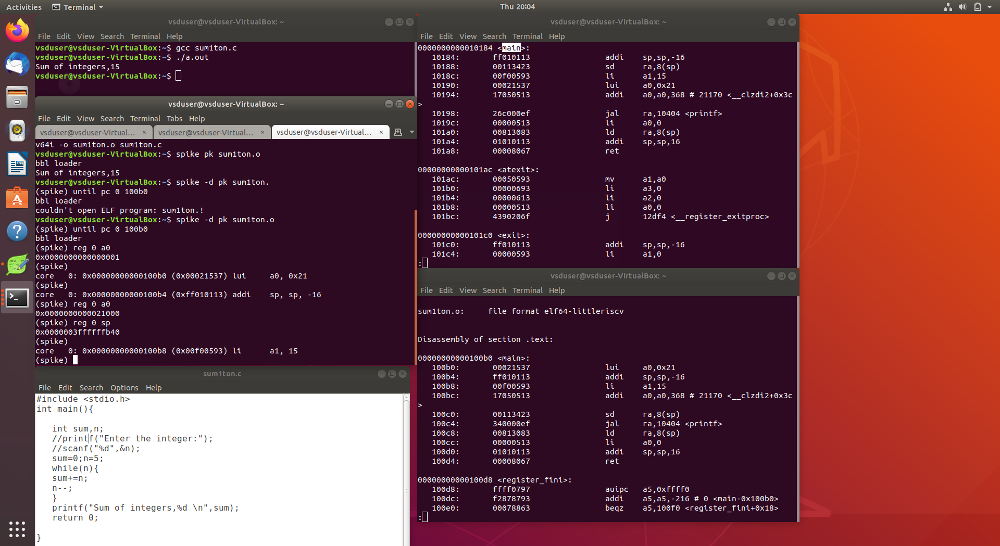
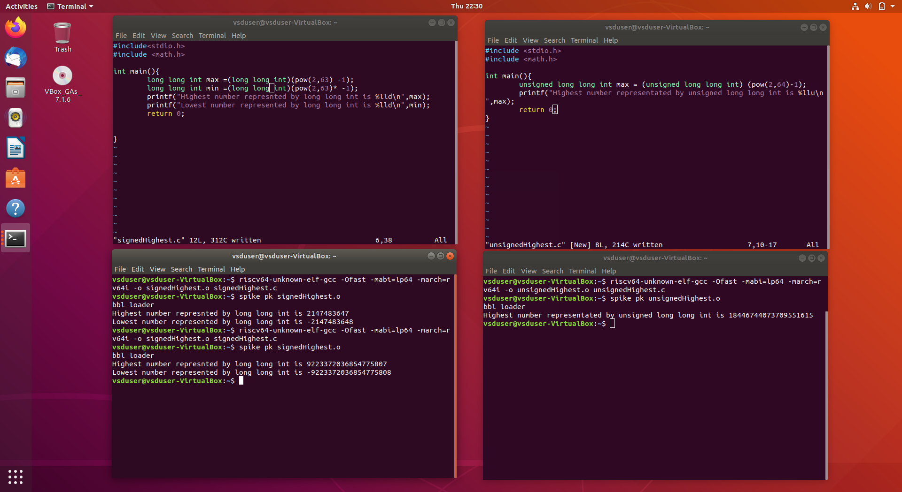

# Day 01 – Introduction to RISC-V ISA and GNU Compiler Toolchain

## 1. Objective

To understand the RISC-V Instruction Set Architecture (ISA), GNU compiler toolchain, basic data representation, and execution of a C program on a RISC-V architecture using Spike simulator.

## 2. Introduction to RISC-V Architecture

A computer system consists of three major layers:

- **Application Software:** Programs written in high-level languages such as C, C++, Java, etc.
- **System Software:** Includes the operating system, compiler, assembler and other system utilities.
- **Hardware:** The processor that executes machine-level instructions.

### Software to Hardware Flow

1. Application programs are written in high-level languages such as C.
2. The compiler translates the high-level program into assembly instructions.
3. The assembler converts assembly instructions into machine code (binary).
4. The processor fetches, decodes and executes these machine instructions.

**Role of ISA:**

Instruction Set Architecture (ISA) acts as an interface between software and hardware. It defines the instructions, registers, data types and operations supported by a processor.

### RTL to Physical Layout

The hardware implementation of the RISC-V processor follows the standard VLSI design flow:

1. Define the processor architecture and specifications.
2. Implement the processor using RTL (Verilog/SystemVerilog).
3. Perform synthesis to generate the gate-level netlist.
4. Perform Physical Design (floorplanning, placement, clock tree synthesis and routing).
5. Generate the final physical layout.


## 3. Contents

- Representation of 64-bit signed and unsigned integers.
- Application Binary Interface (ABI).
- Memory allocation and stack pointer.
- Pseudo instructions.
- RV64I – Base Integer Instruction Set.
- RV64M – Multiplication and Division Extension.
- RV64F – Single-Precision Floating-Point Extension.
- RV64D – Double-Precision Floating-Point Extension.

## 4. GNU Compiler Toolchain

The GNU compiler toolchain is used to compile and execute programs targeting the RISC-V architecture.

### Tools Used

| Tool | Purpose |
|---|---|
| GCC | Compiles C programs |
| RISC-V GCC | Cross-compiles programs for RISC-V |
| ObjDump | Displays assembly instructions |
| Spike | RISC-V ISA simulator |
| Proxy Kernel (pk) | Provides basic execution environment |

## 5. Lab Experiment 01 – Sum of First N Integers

### C Program

File: `sum1ton.c`

```c
#include <stdio.h>

int main()
{
    int sum, n;

    sum = 0;
    n = 5;

    while(n)
    {
        sum += n;
        n--;
    }

    printf("Sum of integers,%d \n", sum);

    return 0;
}
```

### Step 1: Create and execute the C program

```bash
leafpad sum1ton.c
gcc sum1ton.c
./a.out
```

**Output:**

```text
Sum of integers,15
```

### Step 2: Compile using RISC-V GCC

Compile the program for the RV64I architecture using the O1 optimization level.

```bash
riscv64-unknown-elf-gcc -O1 -mabi=lp64 -march=rv64i -o sum1ton_O1.elf sum1ton.c
```

Compile using Ofast optimization:

```bash
riscv64-unknown-elf-gcc -Ofast -mabi=lp64 -march=rv64i -o sum1ton_Ofast.elf sum1ton.c
```

Both compilations generate RISC-V executable files.

### Step 3: View the RISC-V assembly instructions

To view the disassembled instructions:

```bash
riscv64-unknown-elf-objdump -d sum1ton_O1.elf | less
```

Similarly, view the Ofast version:

```bash
riscv64-unknown-elf-objdump -d sum1ton_Ofast.elf | less
```

The disassembly displays the machine instructions along with their corresponding assembly mnemonics and memory addresses.

### Step 4: Execute using Spike Simulator

Run the program using the Spike RISC-V ISA simulator:

```bash
spike pk sum1ton_O1.elf
```

To execute in debug mode:

```bash
spike -d pk sum1ton_O1.elf
```

### Step 5: Debug and observe register values

The following commands were used during the lab session:

```text
until pc 0 100b0
reg 0 a0
```

- `until pc 0 100b0` – Runs the simulator until the specified program counter address.
- `reg 0 a0` – Displays the value of register a0 in the first simulated processor.

The register values can be examined to understand how instructions execute and how data is processed inside the processor.

**Observation:** The C program produced the same output (15) using native GCC and the RISC-V toolchain.
### Experiment 01 – Sum of First N Integers



The screenshot shows:
- C program execution using GCC.
- RISC-V compilation.
- Spike simulator debugging.
- Register value inspection.

## 6. Lab Experiment 02 – Understanding 64-bit Data Representation

RISC-V RV64 architecture supports 64-bit integer operations.

### Basic Data Units

| Unit | Size |
|---|---:|
| Bit | 1 bit |
| Byte | 8 bits |
| Halfword | 16 bits |
| Word | 32 bits |
| Doubleword | 64 bits |

A 64-bit doubleword consists of 8 bytes.

- LSB: Least Significant Bit.
- MSB: Most Significant Bit.

### Unsigned Integer Representation

Unsigned integers represent only non-negative values.

For an n-bit unsigned number, the range is:

\[
0 \text{ to } 2^n-1
\]

For a 64-bit unsigned integer:

\[
0 \text{ to } 2^{64}-1
\]

Example: For a 3-bit unsigned number:

\[
2^3=8
\]

Possible values: 0 to 7.

If an unsigned operation exceeds its representable range, the result wraps around modulo \(2^{64}\) for 64-bit arithmetic.

### Signed Integer Representation – 2's Complement

Signed integers represent both positive and negative numbers using 2's complement representation.

- MSB = 0 indicates a non-negative number.
- MSB = 1 indicates a negative number.

For an n-bit signed integer, the range is:

\[
-2^{n-1} \text{ to } 2^{n-1}-1
\]

For a 64-bit signed integer:

\[
-2^{63} \text{ to } 2^{63}-1
\]

Positive numbers are represented normally in binary.

To represent a negative number:
1. Convert the positive number into binary.
2. Invert all bits (1's complement).
3. Add 1 to obtain the 2's complement representation.

**Note:** Signed and unsigned values have different interpretations even though they use the same number of bits.

### Experiment 02 – Signed and Unsigned Integer Representation



## 7. Important RV64 Instruction Extensions

| Extension | Description |
|---|---|
| RV64I | Base 64-bit integer instructions |
| RV64M | Multiplication and division instructions |
| RV64F | Single-precision floating-point instructions |
| RV64D | Double-precision floating-point instructions |

Examples of assembly instructions observed:

- `addi` – Add immediate.
- `lui` – Load upper immediate.
- `sd` – Store doubleword.
- `ld` – Load doubleword.
- `jal` – Jump and link.
- `ret` – Return from function.
- `li` – Load immediate (pseudo instruction).


## 8. Key Learning Outcomes

1. Understood the relationship between application software, system software and hardware.
2. Learned the role of ISA as an interface between software and hardware.
3. Understood the RISC-V GNU compiler toolchain.
4. Compiled and executed a C program using native GCC and RISC-V GCC.
5. Compared assembly output generated using O1 and Ofast optimization levels.
6. Used ObjDump to inspect RISC-V assembly instructions.
7. Used Spike simulator to debug program execution and inspect register values.
8. Understood 64-bit signed and unsigned integer representations.

---
