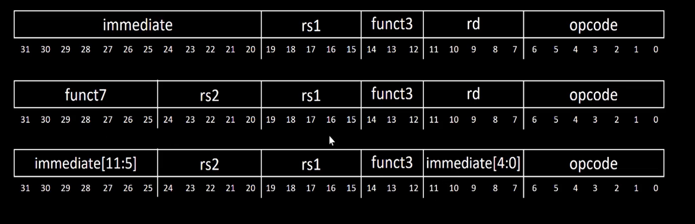
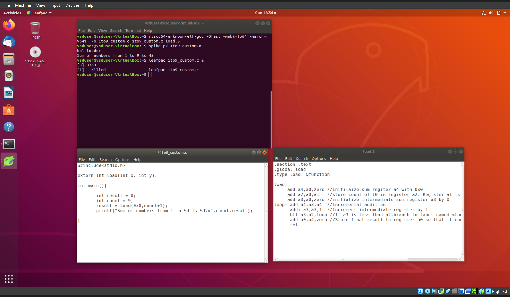
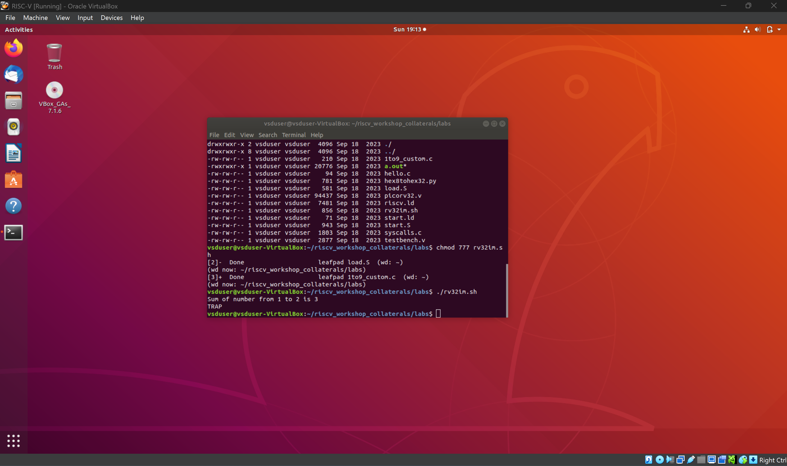

# Day 02 – Application Binary Interface (ABI)

## 1. Objective

To understand the Application Binary Interface (ABI), memory organization, little-endian representation, RISC-V instruction formats, register conventions and the execution of programs using RISC-V assembly and a Verilog-based RISC-V CPU.

## 2. Application to Hardware – Interfaces

The application program communicates with hardware through different software and hardware interfaces.

### Interface Flow


### Interfaces

| Interface | Description |
|---|---|
| API | Application Programming Interface |
| ABI | Application Binary Interface |
| ISA | Instruction Set Architecture |
| RTL | Register Transfer Level |

- **API:** Provides access to standard libraries and functions.
- **ABI:** Defines binary-level conventions such as registers, function calls, data types, stack usage and system call conventions.
- **ISA:** Defines the instructions supported by the processor.
- **RTL:** Describes the hardware implementation of the processor using Verilog/SystemVerilog.

## 3. Memory Organization and Endianness

### 3.1 Memory Allocation

RISC-V RV64 uses 64-bit registers and supports doubleword operations.

| Data unit | Size |
|---|---:|
| Bit | 1 bit |
| Byte | 8 bits |
| Halfword | 16 bits |
| Word | 32 bits |
| Doubleword | 64 bits = 8 bytes |

**Important points:**
- Memory is byte-addressable.
- Each memory location has a unique address.
- One doubleword occupies 8 consecutive byte addresses.
- The next doubleword in a consecutive array starts 8 bytes after the previous one.

Example:

| Doubleword | Starting address |
|---|---|
| DW0 | 0x1000 |
| DW1 | 0x1008 |
| DW2 | 0x1010 |
| DW3 | 0x1018 |

### 3.2 Endianness

Endianness defines how multiple bytes of a data value are arranged in memory.

**Little Endian (used in our RISC-V lab setup)**

The least significant byte (LSB) is stored at the lowest memory address.

**Big Endian**

The most significant byte (MSB) is stored at the lowest memory address.

Example: Consider a 64-bit value:

`0x123456789ABCDEF0`

| Address | Little Endian | Big Endian |
|---|---|---|
| 0x1000 | F0 | 12 |
| 0x1001 | DE | 34 |
| 0x1002 | BC | 56 |
| 0x1003 | 9A | 78 |
| 0x1004 | 78 | 9A |
| 0x1005 | 56 | BC |
| 0x1006 | 34 | DE |
| 0x1007 | 12 | F0 |

### 3.3 Load and Store Instructions

**Load Doubleword (LD)**

```asm
ld x8, 16(x23)
```

- `x23` – Base register.
- `16` – Offset.
- `x8` – Destination register.

Effective address:

`Address = x23 + 16`

The processor loads 8 consecutive bytes from memory, starting at the calculated address, into register `x8`.

Because the lab uses little-endian memory, the byte at the lowest address becomes the least significant byte of the register value.

**Store Doubleword (SD)**

```asm
sd x8, 8(x23)
```

- `x8` – Source register containing the data.
- `x23` – Base register.
- `8` – Offset.

The contents of `x8` are stored into 8 consecutive memory bytes starting at address `x23 + 8`.

## 4. RISC-V Base Integer Instruction Set (RV64I)

RISC-V base integer instructions use a standard 32-bit instruction encoding in the RV64I base ISA.

### 4.1 Instruction Bit Fields

| Field | Bit positions | Size |
|---|---|---:|
| Opcode | [6:0] | 7 bits |
| rd | [11:7] | 5 bits |
| funct3 | [14:12] | 3 bits |
| rs1 | [19:15] | 5 bits |
| rs2 | [24:20] | 5 bits |
| funct7 / immediate | [31:25] | 7 bits |

The exact fields depend on the instruction format.

### 4.2 RISC-V Instruction Formats

There are three important formats covered in this lab:

**R-Type – Register Instructions**

Example:

```asm
add x8, x24, x8
```

Operation:

`x8 = x24 + x8`

Fields:

| Field | Bits |
|---|---|
| funct7 | [31:25] |
| rs2 | [24:20] |
| rs1 | [19:15] |
| funct3 | [14:12] |
| rd | [11:7] |
| opcode | [6:0] |

**I-Type – Immediate Instructions**

Example:

```asm
ld x8, 16(x23)
```

Fields:

| Field | Bits |
|---|---|
| Immediate | [31:20] |
| rs1 | [19:15] |
| funct3 | [14:12] |
| rd | [11:7] |
| opcode | [6:0] |

**S-Type – Store Instructions**

Example:

```asm
sd x8, 8(x23)
```

Fields:

| Field | Bits |
|---|---|
| Immediate [11:5] | [31:25] |
| rs2 | [24:20] |
| rs1 | [19:15] |
| funct3 | [14:12] |
| Immediate [4:0] | [11:7] |
| opcode | [6:0] |

### 4.3 Instruction Set Bit Map



The screenshot illustrates the bit positions and field arrangement of the R, I and S instruction formats.

## 5. RISC-V Registers and ABI Names

RISC-V contains 32 general-purpose integer registers, from `x0` to `x31`.

Each register has a corresponding ABI name.

### Register ABI Table

| Register | ABI Name | Purpose |
|---|---|---|
| x0 | zero | Constant zero |
| x1 | ra | Return address |
| x2 | sp | Stack pointer |
| x3 | gp | Global pointer |
| x4 | tp | Thread pointer |
| x5 | t0 | Temporary |
| x6 | t1 | Temporary |
| x7 | t2 | Temporary |
| x8 | s0 / fp | Saved register / Frame pointer |
| x9 | s1 | Saved register |
| x10 | a0 | Function argument / Return value |
| x11 | a1 | Function argument / Return value |
| x12 | a2 | Function argument |
| x13 | a3 | Function argument |
| x14 | a4 | Function argument |
| x15 | a5 | Function argument |
| x16 | a6 | Function argument |
| x17 | a7 | Function argument |
| x18–x27 | s2–s11 | Saved registers |
| x28 | t3 | Temporary |
| x29 | t4 | Temporary |
| x30 | t5 | Temporary |
| x31 | t6 | Temporary |

**Important:**
- `x0` always contains zero.
- `a0–a7` are used for function arguments.
- `a0` and `a1` are also used for returning values.
- `sp` is used to manage the stack.
- `ra` stores the return address.

## 6. Lab 1 – Sum of N Integers Using RISC-V Assembly

### Objective

To convert the C program for calculating the sum of integers from 1 to N into RISC-V assembly and understand how the program executes using registers and instructions.

### C Program

```c
#include <stdio.h>

int sum1ton(int n)
{
    int sum = 0;

    while(n)
    {
        sum += n;
        n--;
    }

    return sum;
}

int main()
{
    int n = 5;
    int result = sum1ton(n);

    printf("Sum of integers = %d\n", result);

    return 0;
}
```

### Assembly Conversion

The C program is compiled into RISC-V assembly instructions.

The assembly code demonstrates:
- Passing function arguments through registers.
- Using registers for arithmetic operations.
- Implementing loops using branch instructions.
- Returning function results through the ABI convention.

### Important Instructions

| Instruction | Operation |
|---|---|
| add | Register addition |
| addi | Addition with immediate |
| sub | Register subtraction |
| ld | Load doubleword |
| sd | Store doubleword |
| bnez | Branch if not zero |
| jal | Jump and link |
| ret | Return from function |

### Compilation Command

```bash
riscv64-unknown-elf-gcc -O1 -mabi=lp64 -march=rv64i -S sum1ton.c -o sum1ton.s
```

To view the generated assembly:

```bash
leafpad sum1ton.s
```

To generate an object file:

```bash
riscv64-unknown-elf-gcc -O1 -mabi=lp64 -march=rv64i -c sum1ton.c -o sum1ton.o
```

To view the disassembled instructions:

```bash
riscv64-unknown-elf-objdump -d sum1ton.o | less
```

### Lab Observation

The C program and its corresponding RISC-V assembly instructions were examined.

The function call demonstrates how arguments are passed using ABI-defined registers and how the calculated result is returned to the calling function.

### Lab Screenshot



## 7. Lab 2 – RISC-V CPU Using Verilog and Hexadecimal Program

### Objective

To understand how a RISC-V CPU implemented using Verilog executes a program stored in hexadecimal format in instruction memory.

### Concept

In this experiment, a RISC-V CPU is implemented using Verilog.

Instead of directly executing a C program, the program is first converted into machine instructions. These instructions are represented in hexadecimal format and stored in the instruction memory of the processor.

### Execution Flow

```text
       C Program
       sum1ton.c
           |
           v
    RISC-V Compiler
           |
           v
    Machine Instructions
           |
           v
      Hex File (.hex)
           |
           v
   Instruction Memory
           |
           v
    RISC-V CPU (Verilog)
           |
           v
    Instruction Decode
           |
           v
     Instruction Execute
           |
           v
      Data Memory
           |
           v
         Output
    Sum from 1 to N
```

### Working

1. Write the C program to calculate the sum of integers from 1 to N.
2. Compile the program for the RISC-V architecture.
3. Convert the generated machine instructions into hexadecimal format.
4. Load the hexadecimal instructions into the Verilog CPU's instruction memory.
5. The CPU fetches instructions from memory.
6. The control unit decodes the instructions.
7. The execution unit performs arithmetic and logical operations.
8. The result is produced after the program completes execution.

**Key Understanding:** The hexadecimal file contains the machine-code instructions that the Verilog-based RISC-V CPU fetches and executes.

### Lab Screenshot



## 8. Key Learning Outcomes

1. Understood the role of ABI in communication between compiled software and the operating system.
2. Learned memory organization and byte-addressable memory.
3. Understood little-endian and big-endian data representation.
4. Learned RISC-V load and store instructions.
5. Studied the 32-bit instruction encoding of RV64I.
6. Understood R-Type, I-Type and S-Type instruction formats.
7. Learned the 32 general-purpose registers and their ABI names.
8. Converted a C program into RISC-V assembly.
9. Understood function argument passing and return values using ABI conventions.
10. Learned how a Verilog-based RISC-V CPU executes instructions stored in hexadecimal format.

---
