# Day 02 – Application Binary Interface (ABI)

## 1. Objective

To study the RISC-V software-to-hardware interface, memory organization, ABI register and function-calling conventions, instruction formats, and assembly-level program execution. The day also explores GCC's handling of assembly source files (.s and .S), stack management, integer overflow, multiplication and division, and IEEE 754 floating-point operations.

## 2. Application to Hardware – Interfaces

The application program communicates with hardware through different software and hardware interfaces.

### Interface Flow

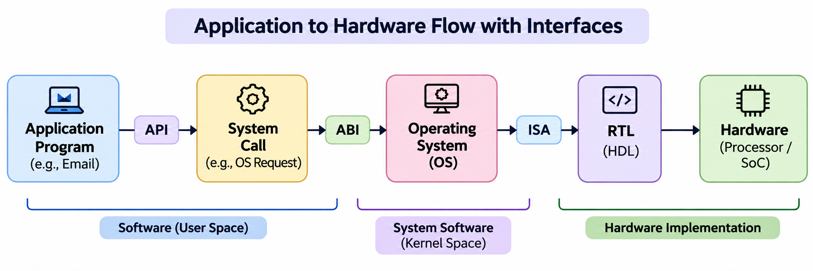


### Interfaces

| Interface | Description |
|---|---|
| API | Application Programming Interface |
| ABI | Application Binary Interface |
| ISA | Instruction Set Architecture |
| RTL | Register Transfer Level |

- **API:** Provides access to standard libraries and functions.
- **ABI:** Defines binary-level conventions such as registers, function calls, data types, stack usage and system call conventions.
- **ISA:** Defines the instructions supported by the processor.
- **RTL:** Describes the hardware implementation of the processor using Verilog/SystemVerilog.

## 3. Memory Organization and Endianness

### 3.1 Memory Allocation

RISC-V RV64 uses 64-bit registers and supports doubleword operations.

| Data unit | Size |
|---|---:|
| Bit | 1 bit |
| Byte | 8 bits |
| Halfword | 16 bits |
| Word | 32 bits |
| Doubleword | 64 bits = 8 bytes |

**Important points:**
- Memory is byte-addressable.
- Each memory location has a unique address.
- One doubleword occupies 8 consecutive byte addresses.
- The next doubleword in a consecutive array starts 8 bytes after the previous one.

Example:

| Doubleword | Starting address |
|---|---|
| DW0 | 0x1000 |
| DW1 | 0x1008 |
| DW2 | 0x1010 |
| DW3 | 0x1018 |

### 3.2 Endianness

Endianness defines how multiple bytes of a data value are arranged in memory.

**Little Endian (used in our RISC-V lab setup)**

The least significant byte (LSB) is stored at the lowest memory address.

**Big Endian**

The most significant byte (MSB) is stored at the lowest memory address.

Example: Consider a 64-bit value:

`0x123456789ABCDEF0`

| Address | Little Endian | Big Endian |
|---|---|---|
| 0x1000 | F0 | 12 |
| 0x1001 | DE | 34 |
| 0x1002 | BC | 56 |
| 0x1003 | 9A | 78 |
| 0x1004 | 78 | 9A |
| 0x1005 | 56 | BC |
| 0x1006 | 34 | DE |
| 0x1007 | 12 | F0 |

### 3.3 Load and Store Instructions

**Load Doubleword (LD)**

```asm
ld x8, 16(x23)
```

- `x23` – Base register.
- `16` – Offset.
- `x8` – Destination register.

Effective address:

`Address = x23 + 16`

The processor loads 8 consecutive bytes from memory, starting at the calculated address, into register `x8`.

Because the lab uses little-endian memory, the byte at the lowest address becomes the least significant byte of the register value.

**Store Doubleword (SD)**

```asm
sd x8, 8(x23)
```

- `x8` – Source register containing the data.
- `x23` – Base register.
- `8` – Offset.

The contents of `x8` are stored into 8 consecutive memory bytes starting at address `x23 + 8`.

## 4. RISC-V Base Integer Instruction Set (RV64I)

RISC-V base integer instructions use a standard 32-bit instruction encoding in the RV64I base ISA.

### 4.1 Instruction Bit Fields

| Field | Bit positions | Size |
|---|---|---:|
| Opcode | [6:0] | 7 bits |
| rd | [11:7] | 5 bits |
| funct3 | [14:12] | 3 bits |
| rs1 | [19:15] | 5 bits |
| rs2 | [24:20] | 5 bits |
| funct7 / immediate | [31:25] | 7 bits |

The exact fields depend on the instruction format.

### 4.2 RISC-V Instruction Formats

There are three important formats covered in this lab:

**R-Type – Register Instructions**

Example:

```asm
add x8, x24, x8
```

Operation:

`x8 = x24 + x8`

Fields:

| Field | Bits |
|---|---|
| funct7 | [31:25] |
| rs2 | [24:20] |
| rs1 | [19:15] |
| funct3 | [14:12] |
| rd | [11:7] |
| opcode | [6:0] |

**I-Type – Immediate Instructions**

Example:

```asm
ld x8, 16(x23)
```

Fields:

| Field | Bits |
|---|---|
| Immediate | [31:20] |
| rs1 | [19:15] |
| funct3 | [14:12] |
| rd | [11:7] |
| opcode | [6:0] |

**S-Type – Store Instructions**

Example:

```asm
sd x8, 8(x23)
```

Fields:

| Field | Bits |
|---|---|
| Immediate [11:5] | [31:25] |
| rs2 | [24:20] |
| rs1 | [19:15] |
| funct3 | [14:12] |
| Immediate [4:0] | [11:7] |
| opcode | [6:0] |

### 4.3 Instruction Set Bit Map


The screenshot illustrates the bit positions and field arrangement of the R, I and S instruction formats.

## 5. RISC-V Registers and ABI Names

RISC-V contains 32 general-purpose integer registers, from `x0` to `x31`.

Each register has a corresponding ABI name.

### Register ABI Table

| Register | ABI Name | Purpose |
|---|---|---|
| x0 | zero | Constant zero |
| x1 | ra | Return address |
| x2 | sp | Stack pointer |
| x3 | gp | Global pointer |
| x4 | tp | Thread pointer |
| x5 | t0 | Temporary |
| x6 | t1 | Temporary |
| x7 | t2 | Temporary |
| x8 | s0 / fp | Saved register / Frame pointer |
| x9 | s1 | Saved register |
| x10 | a0 | Function argument / Return value |
| x11 | a1 | Function argument / Return value |
| x12 | a2 | Function argument |
| x13 | a3 | Function argument |
| x14 | a4 | Function argument |
| x15 | a5 | Function argument |
| x16 | a6 | Function argument |
| x17 | a7 | Function argument |
| x18–x27 | s2–s11 | Saved registers |
| x28 | t3 | Temporary |
| x29 | t4 | Temporary |
| x30 | t5 | Temporary |
| x31 | t6 | Temporary |

**Important:**
- `x0` always contains zero.
- `a0–a7` are used for function arguments.
- `a0` and `a1` are also used for returning values.
- `sp` is used to manage the stack.
- `ra` stores the return address.

## 6. Lab 1 – Sum of N Integers Using RISC-V Assembly

### Objective

To convert the C program for calculating the sum of integers from 1 to N into RISC-V assembly and understand how the program executes using registers and instructions.

### C Program

```c
#include <stdio.h>

int sum1ton(int n)
{
    int sum = 0;

    while(n)
    {
        sum += n;
        n--;
    }

    return sum;
}

int main()
{
    int n = 5;
    int result = sum1ton(n);

    printf("Sum of integers = %d\n", result);

    return 0;
}
```

### Assembly Conversion

The C program is compiled into RISC-V assembly instructions.

The assembly code demonstrates:
- Passing function arguments through registers.
- Using registers for arithmetic operations.
- Implementing loops using branch instructions.
- Returning function results through the ABI convention.

### Important Instructions

| Instruction | Operation |
|---|---|
| add | Register addition |
| addi | Addition with immediate |
| sub | Register subtraction |
| ld | Load doubleword |
| sd | Store doubleword |
| bnez | Branch if not zero |
| jal | Jump and link |
| ret | Return from function |

### Compilation Command

```bash
riscv64-unknown-elf-gcc -O1 -mabi=lp64 -march=rv64i -S sum1ton.c -o sum1ton.s
```

To view the generated assembly:

```bash
leafpad sum1ton.s
```

To generate an object file:

```bash
riscv64-unknown-elf-gcc -O1 -mabi=lp64 -march=rv64i -c sum1ton.c -o sum1ton.o
```

To view the disassembled instructions:

```bash
riscv64-unknown-elf-objdump -d sum1ton.o | less
```

### GCC Assembly Preprocessing: `.s` vs `.S`

During the assembly exercise, a file containing `//` comments produced assembler errors. The issue highlighted how GCC handles lowercase and uppercase assembly file extensions:

| Extension | Processing |
|---|---|
| `.s` | Sent directly to the assembler; the C preprocessor is not run automatically. |
| `.S` | Preprocessed by the C preprocessor before being sent to the assembler. |

**Compilation flow:**

```text
load.s  -> GNU Assembler -> Object file
load.S  -> C Preprocessor -> GNU Assembler -> Object file
```

This matters when the source uses C-preprocessor directives or C-style comments. In a plain `.s` file, `//` may not be treated as a comment by the assembler and can lead to errors such as *unrecognized opcode* or *illegal operands*. Renaming the file to `.S` enables preprocessing before assembly.

To inspect the preprocessed output:

```bash
riscv64-unknown-elf-gcc -E load.S
```

**Key takeaway:** GCC uses the capitalization of the assembly filename to decide whether to run the C preprocessor. Use `.S` when preprocessing is required; use `.s` for assembly that should go directly to the assembler.

### Lab Observation

The C program and its corresponding RISC-V assembly instructions were examined.

The function call demonstrates how arguments are passed using ABI-defined registers and how the calculated result is returned to the calling function.

### Lab Screenshot


## 7. Lab 2 – RISC-V CPU Using Verilog and Hexadecimal Program

### Objective

To understand how a RISC-V CPU implemented using Verilog executes a program stored in hexadecimal format in instruction memory.

### Concept

In this experiment, a RISC-V CPU is implemented using Verilog.

Instead of directly executing a C program, the program is first converted into machine instructions. These instructions are represented in hexadecimal format and stored in the instruction memory of the processor.

### Execution Flow
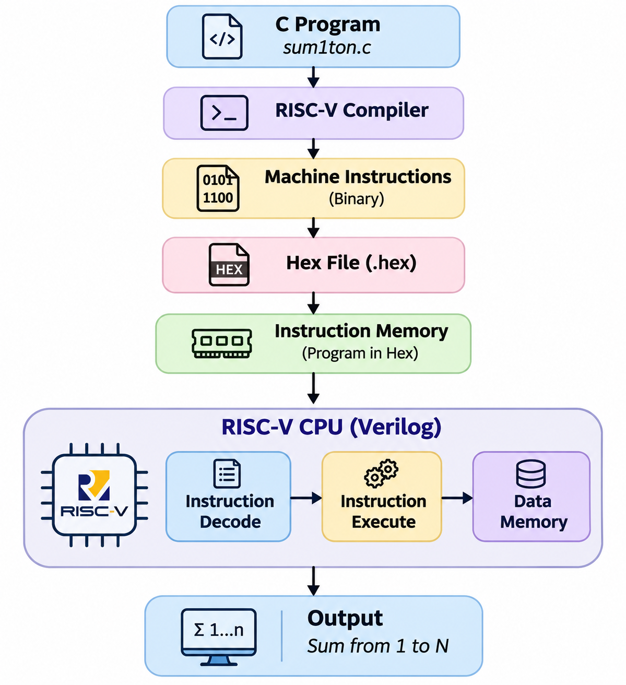
### Working

1. Write the C program to calculate the sum of integers from 1 to N.
2. Compile the program for the RISC-V architecture.
3. Convert the generated machine instructions into hexadecimal format.
4. Load the hexadecimal instructions into the Verilog CPU's instruction memory.
5. The CPU fetches instructions from memory.
6. The control unit decodes the instructions.
7. The execution unit performs arithmetic and logical operations.
8. The result is produced after the program completes execution.

**Key Understanding:** The hexadecimal file contains the machine-code instructions that the Verilog-based RISC-V CPU fetches and executes.

### Lab Screenshot


## 8. Memory Allocation and Stack Pointer

### 8.1 Function Calling Convention

Function arguments, return values and preserved registers follow the ABI conventions summarized in **Section 5 – RISC-V Registers and ABI Names**. This section focuses on how those conventions are applied during procedure calls.

The Program Counter (PC) is a separate processor register and is not part of the general-purpose registers x0–x31.

### 8.2 Jump and Link – JAL

The `jal` instruction transfers control to a procedure and saves the return address.

```asm
jal x1, ProcAddress
```

- x1 (ra) stores the return address (PC + 4).
- The PC is updated with the target procedure address.
- After execution of the procedure, the saved return address is used to return to the caller.

**Instruction format:** J-Type.

### 8.3 Jump and Link Register – JALR

The `jalr` instruction performs an indirect jump using a register and an immediate offset.

```asm
jalr x0, 0(x1)
```

Working:

1. The contents of x1 are added to the immediate offset of zero.
2. The calculated target address is loaded into the PC.
3. The destination register is x0, which is hardwired to zero.
4. The return address generated by JALR is discarded.

Therefore, control returns to the calling function.

**Instruction format:** I-Type.

`ret` is a pseudo-instruction equivalent to:

```asm
jalr x0, 0(ra)
```

### 8.4 Caller-Saved and Callee-Saved Registers

During function execution, registers may contain important data that must be preserved.

- **Caller-saved:** The calling function must preserve values it needs after a function call. These include t0–t6 and a0–a7.
- **Callee-saved:** The called function must restore these registers to their original values before returning. These include s0–s11.

When a procedure needs to preserve register values, it can save them in memory using the stack.

### 8.5 Stack Pointer

The stack is a memory region used to store:
- Return addresses.
- Saved registers.
- Local variables.
- Temporary data.

Important points:

- x2 is dedicated to the stack pointer (sp).
- The stack grows towards lower memory addresses.
- The stack pointer identifies the current top of the stack.
- RV64 stack frames are generally aligned to 16 bytes at procedure-call boundaries.

### 8.6 Stack Allocation Example

Consider the following instructions:

```asm
addi sp, sp, -48
sd   ra, 40(sp)
```

Assume the initial stack pointer is:

`sp = 0x140`

**Step 1 – Allocate memory**

```asm
addi sp, sp, -48
```

48 decimal = 0x30 hexadecimal.

Therefore:

`sp = 0x140 - 0x30 = 0x110`

A 48-byte stack frame is allocated.

**Step 2 – Store return address**

```asm
sd ra, 40(sp)
```

Assume:

`ra = 0x100`

Effective address:

`0x110 + 40 decimal = 0x110 + 0x28 = 0x138`

The return address 0x100 is stored at memory address 0x138.

### Stack Memory Illustration

| Address | Contents |
|---|---|
| 0x138 | Saved return address (0x100) |
| 0x130 | Available |
| 0x128 | Available |
| 0x120 | Available |
| 0x118 | Available |
| 0x110 | Current stack pointer |

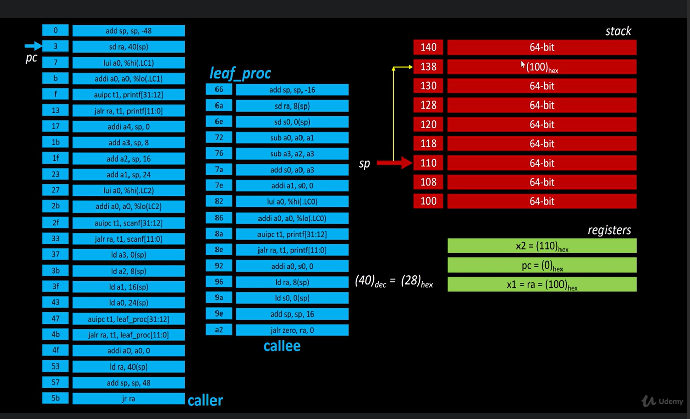

**Observation:** Stack memory allows a function to preserve important register values and restore them before returning to the calling function.

## 9. Pseudo-Instructions and Immediate Loading

### 9.1 Pseudo-Instructions

Pseudo-instructions are convenient assembly instructions that simplify programming. The assembler translates them into one or more actual machine instructions.

| Pseudo-instruction | Equivalent |
|---|---|
| `mv rd, rs` | `addi rd, rs, 0` |
| `ret` | `jalr x0, 0(ra)` |
| `j label` | `jal x0, label` |
| `nop` | `addi x0, x0, 0` |
| `li rd, imm` | One or more instructions depending on the immediate |

Note: `printf()` and `scanf()` are library functions, not assembly pseudo-instructions.

### 9.2 Load Upper Immediate – LUI

The LUI instruction loads a 20-bit immediate into bits [31:12] of the destination register, with the lower 12 bits set to zero. The resulting 32-bit value is sign-extended to XLEN.

Example:

```asm
lui a0, %hi(.LC1)
```

Assume:

`.LC1 = 0x32143678`

The upper portion is:

`0x32143`

The resulting value in a0 is:

`0x0000000032143000`

The lower 12 bits are loaded using:

```asm
addi a0, a0, %lo(.LC1)
```

Adding:

`0x678`

Final value:

`a0 = 0x0000000032143678`

Here, a0 is x10, commonly used to pass the first function argument.

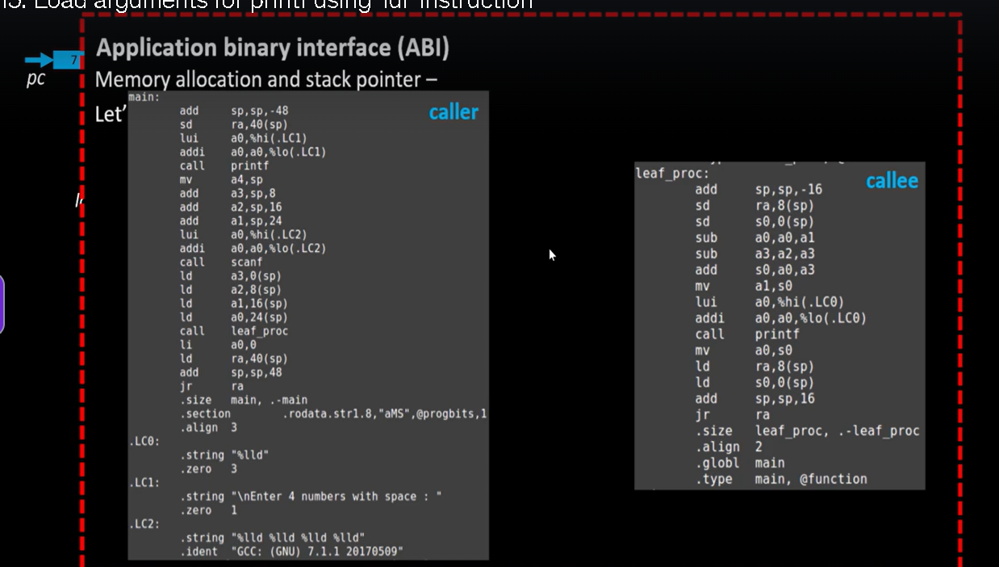

### 9.3 AUIPC – Add Upper Immediate to PC

AUIPC adds an upper immediate value, shifted left by 12 bits, to the current PC and stores the result in the destination register.

Example:

```asm
auipc t1, %pcrel_hi(printf)
```

- t1 is x6, a temporary register.
- The upper portion of the PC-relative address is added to the current PC.
- The result is stored in t1.

The lower 12-bit offset is then used by JALR.

### 9.4 PC-Relative Function Addressing

A 12-bit immediate alone cannot represent every address in a large program.

RISC-V therefore uses PC-relative addressing to reach functions and other program locations.

Example:

```asm
auipc t1, %pcrel_hi(printf)
jalr  ra, %pcrel_lo(printf)(t1)
```

**Step 1 – AUIPC**

Calculates the upper portion of the PC-relative address and stores it in t1.

**Step 2 – JALR**

Adds the lower 12-bit offset to t1 to calculate the target address.

At the same time:

`ra = PC + 4`

The PC is updated to the target address of printf.

The PC is not a general-purpose register. Instructions such as ADD cannot directly write to it. Control-flow instructions such as JAL and JALR update the PC.

### 9.5 Returning to the Calling Function

```asm
jalr x0, 0(ra)
```

- The return address is obtained from ra.
- The PC is updated with the return address.
- The generated PC + 4 value is discarded because the destination is x0.

This completes the procedure return.

## 10. Analysis of RISC-V Assembly Program

### 10.1 C Program

The following program accepts four integers, calculates `(a-b)+(c-d)` and displays the result.

```c
#include <stdio.h>

int leaf_proc(int a, int b, int c, int d)
{
    int result;

    result = (a - b) + (c - d);

    printf("Result = %d\n", result);

    return result;
}

int main()
{
    int a, b, c, d;
    int result;

    printf("Enter four integers: ");
    scanf("%d %d %d %d", &a, &b, &c, &d);

    result = leaf_proc(a, b, c, d);

    return 0;
}
```

### 10.2 Main Function – Stack Allocation

The assembly begins with:

```asm
addi sp, sp, -48
sd   ra, 40(sp)
```

- A 48-byte stack frame is allocated.
- The return address is saved in the stack.
- This preserves the original return address during subsequent function calls.

### 10.3 Preparing Arguments for scanf

The following instructions calculate addresses within the stack:

```asm
addi a4, sp, 0
addi a3, sp, 8
addi a2, sp, 16
addi a1, sp, 24
```

Assuming:

`sp = 0x110`

| Register | Calculated address |
|---|---|
| a4 (x14) | 0x110 |
| a3 (x13) | 0x118 |
| a2 (x12) | 0x120 |
| a1 (x11) | 0x128 |

These registers hold the addresses of the input variables.

Next, the format string is loaded and scanf is called:

```asm
lui   a0, %hi(.LC2)
addi  a0, a0, %lo(.LC2)

auipc t1, %pcrel_hi(scanf)
jalr  ra, %pcrel_lo(scanf)(t1)
```

Here:
- a0 holds the format string address.
- a1–a4 hold the addresses of the input variables.
- AUIPC and JALR transfer control to scanf.

### 10.4 Loading Input Values from Stack

After scanf completes, the input values are retrieved from memory using load instructions.

Conceptually:

```asm
ld a3, 0(sp)
ld a2, 8(sp)
ld a1, 16(sp)
ld a0, 24(sp)
```

These instructions load the stored values into argument registers.

The actual generated instructions and offsets should be verified against the workshop assembly screenshot.

### 10.5 Calling leaf_proc

The four arguments are passed through a0, a1, a2 and a3.

The function is called using the PC-relative AUIPC and JALR sequence.

The return address is saved in ra.

### 10.6 leaf_proc – Stack Allocation

Inside the procedure:

```asm
addi sp, sp, -16
sd   ra, 8(sp)
sd   s0, 0(sp)
```

Assume the previous stack pointer was:

`sp = 0x110`

After allocation:

`sp = 0x100`

| Address | Stored value |
|---|---|
| 0x108 | Return address (ra) |
| 0x100 | Previous s0 |

This ensures that the original register values are preserved.

### 10.7 Arithmetic Operations

```asm
sub a0, a0, a1
sub a3, a2, a3
add s0, a0, a3
```

The operations are:

1. Calculate a − b and store the result in a0.
2. Calculate c − d and store the result in a3.
3. Add both results and store the final value in s0.

Mathematically:

```text
s0=(a-b)+(c-d)
```

The result is moved to a1:

```asm
addi a1, s0, 0
```

This copies the result from s0 to a1.

### 10.8 Calling printf

```asm
lui   a0, %hi(.LC1)
addi  a0, a0, %lo(.LC1)

auipc t1, %pcrel_hi(printf)
jalr  ra, %pcrel_lo(printf)(t1)
```

The format string is loaded into a0 and the result is passed as an argument. The processor transfers control to printf.

### 10.9 Restoring the Stack

Before returning:

```asm
ld   ra, 8(sp)
ld   s0, 0(sp)
addi sp, sp, 16
jalr x0, 0(ra)
```

- The saved return address is restored.
- The previous s0 value is restored.
- The stack pointer is returned to its original position.
- Control returns to the calling function.

### 10.10 Returning to main

The main function restores its own stack frame:

```asm
ld   ra, 40(sp)
addi sp, sp, 48
jr   ra
```

The saved return address is loaded, the stack pointer is restored, and execution returns to the original calling location.

**Observation:** This experiment demonstrates function calling conventions, argument passing, register preservation, stack allocation and procedure returns in RISC-V assembly.

## 11. Signed Integer Overflow Conditions

### 11.1 Signed Integer Range

For an n-bit signed integer represented using 2's complement:

```text
-2^{n-1} to 2^{n-1}-1
```

For a 64-bit signed integer:

```text
-2^{63} to 2^{63}-1
```

The positive range is `0` to `2^63 - 1`, and the negative range is `-2^63` to `-1`.

### 11.2 Understanding Overflow Using 4 Bits

A 4-bit signed integer represents values from -8 to +7.

Consider:

```text
+6 + +4 = +10
```

However, +10 cannot be represented using 4-bit signed integers.

```text
  0110  (+6)
+ 0100  (+4)
------
  1010  (-6)
```

The result has an incorrect sign, indicating signed overflow.

### 11.3 Signed Addition Overflow

Overflow occurs in two situations:

1. Both operands are positive, but the result becomes negative.
2. Both operands are negative, but the result becomes positive.

In terms of sign bits:

- If both operands have the same sign,
- but the result has a different sign,
- signed overflow has occurred.


### 11.4 Overflow Detection Example

```asm
add  t0, t1, t2
slti t3, t2, 0
slt  t4, t0, t1
bne  t3, t4, overflow
```

| Instruction | Description | Format |
|---|---|---|
| add | Adds two registers | R-Type |
| slti | Sets destination if register is less than immediate | I-Type |
| slt | Sets destination if one register is less than another | R-Type |
| bne | Branches if two registers are not equal | B-Type |

Example:

`t1 = +6`, `t2 = -4`

The result is +2, so no signed overflow occurs.

The above sequence is a comparison example, not a general signed-overflow detector for all operands.

A general signed addition overflow condition is:

```text
Overflow=(sign(A)=sign(B))AND(sign(Result)!= sign(A))
```

### 11.5 Signed Subtraction Overflow

Subtraction can be implemented using addition hardware:

```text
A-B=A+(-B)
```

The negative value of B is obtained using 2's complement:

1. Invert all bits.
2. Add 1.
3. Add the result to A.

Signed subtraction overflow occurs when:

- A and B have different signs.
- The result sign differs from the sign of A.

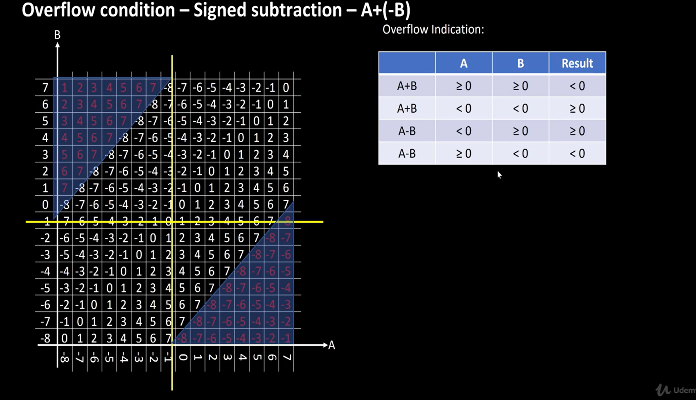

The general condition is:

```text
Overflow=(sign(A)!= sign(B))AND(sign(Result)!= sign(A))
```

## 12. Complete RISC-V Instruction Formats

RISC-V base integer instructions use six major instruction formats.

| Format | Purpose | Example |
|---|---|---|
| R-Type | Register operations | `add x8,x24,x8` |
| I-Type | Immediate and load operations | `ld x8,16(x23)` |
| S-Type | Store operations | `sd x8,8(x23)` |
| B-Type | Conditional branches | `bne t3,t4,overflow` |
| U-Type | Upper immediate operations | `lui a0,0x32143` |
| J-Type | Unconditional jump and link | `jal ra,label` |

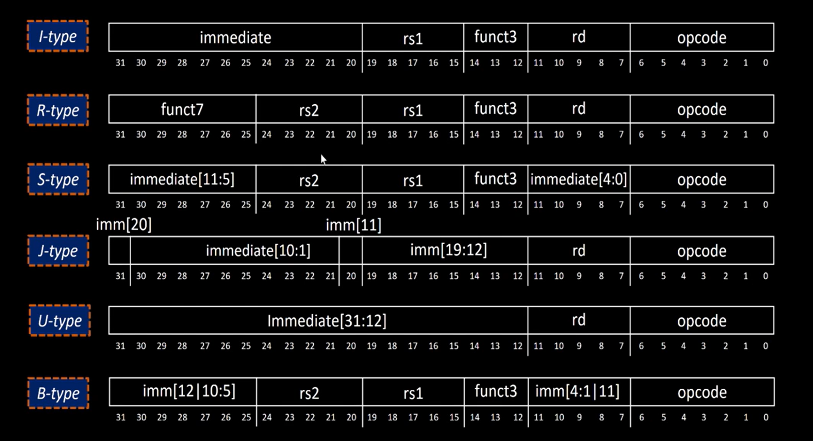

The six formats use different arrangements of opcode, register fields, function fields and immediate values.

## 13. RV64M – Multiplication Extension

RV64M extends the base integer instruction set with multiplication and division operations.

### 13.1 Binary Multiplication Algorithm

Consider multiplying two 4-bit binary numbers. The product can require up to 8 bits.

**Algorithm**

1. Initialize product = 0.
2. Initialize the counter = 4.
3. Check the least significant bit of the multiplier.
4. If it is 1, add the multiplicand to the product.
5. If it is 0, skip the addition.
6. Shift the multiplicand left by one bit.
7. Shift the multiplier right by one bit.
8. Decrement the counter.
9. If the counter is not zero, repeat from Step 3.
10. Otherwise, output the product.

### Multiplication Flowchart

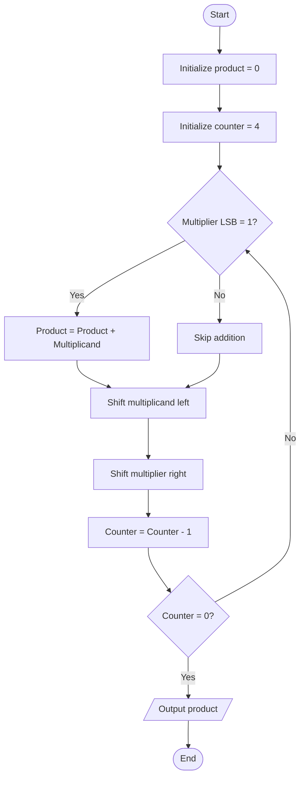

### 13.2 Extending to 64-Bit Multiplication

For 64-bit multiplication, the complete product can require 128 bits.

Therefore, the multiplication process must account for both:
- Lower 64 bits.
- Upper 64 bits.

### 13.3 RISC-V Multiplication Instructions

| Instruction | Operation |
|---|---|
| MUL | Lower XLEN bits of product |
| MULH | Upper XLEN bits of signed × signed product |
| MULHU | Upper XLEN bits of unsigned × unsigned product |
| MULHSU | Upper XLEN bits of signed × unsigned product |

Example:

```asm
mulh t0, t1, t2
mul  t3, t1, t2
```

- `mulh` stores the upper 64 bits of the signed product in t0.
- `mul` stores the lower 64 bits of the product in t3.
- Source registers t1 and t2 remain unchanged.

These are R-Type instructions.

## 14. Binary Division Algorithm

Binary division can be implemented using repeated subtraction, comparison and shifting operations.

### 14.1 Initialization

1. Initialize the remainder register with the dividend.
2. Place the divisor in the left half of the working register.
3. Initialize the quotient to zero.
4. Initialize the iteration counter.

### 14.2 Division Procedure

1. Subtract the divisor from the remainder.
2. Check whether the remainder is negative.
3. If negative, restore the previous remainder by adding the divisor.
4. Shift the quotient left by one bit.
5. Set the quotient LSB to zero.
6. Shift the divisor right by one bit.
7. Decrement the counter.
8. Repeat until the counter reaches zero.

If the subtraction result is non-negative:

- Keep the updated remainder.
- Shift the quotient left.
- Set its LSB to one.
- Continue the iteration.

### Division Flowchart

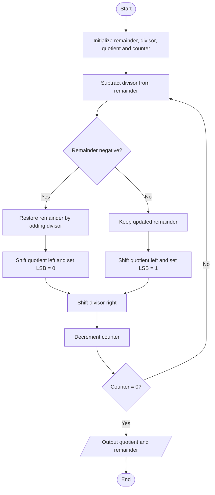

## 15. RV64F and RV64D – Floating-Point Extensions

RISC-V supports floating-point operations through:

- RV64F – Single-precision floating-point operations.
- RV64D – Double-precision floating-point operations.

### 15.1 Scientific Notation and Binary Normalization

Consider:

```text
123.625
```

Binary representation:

```text
1111011.101_2
```

Normalized binary representation:

```text
1.111011101×2^6
```

Normalized representation places one non-zero digit before the decimal point in decimal notation, or one leading 1 before the binary point in normalized binary notation.

### 15.2 IEEE 754 Single-Precision Format

Single precision uses 32 bits.

| Field | Bit positions | Size |
|---|---|---|
| Sign | 31 | 1 bit |
| Exponent | 30–23 | 8 bits |
| Fraction | 22–0 | 23 bits |

The normalized representation is:

```text
(-1)^S×(1.F)×2^{E-127}
```

Where:
- S represents the sign.
- F represents the fraction.
- E represents the biased exponent.
- 127 is the exponent bias.

### 15.3 IEEE 754 Double-Precision Format

Double precision uses 64 bits.

| Field | Bit positions | Size |
|---|---|---|
| Sign | 63 | 1 bit |
| Exponent | 62–52 | 11 bits |
| Fraction | 51–0 | 52 bits |

The normalized representation is:

```text
(-1)^S×(1.F)×2^{E-1023}
```

The exponent bias for double precision is 1023.

### 15.4 Special Floating-Point Values

| Exponent | Fraction | Representation |
|---|---|---|
| All zeros | All zeros | Positive or negative zero |
| All zeros | Non-zero | Subnormal number |
| Normal range | Any | Normalized number |
| All ones | All zeros | Positive or negative infinity |
| All ones | Non-zero | NaN (Not a Number) |

### 15.5 Subnormal Numbers

Subnormal numbers represent very small non-zero values closer to zero than the smallest normalized number.

Unlike normalized numbers, subnormal numbers do not have an implicit leading 1.

For single precision, their effective exponent is:

```text
1-127=-126
```

For double precision:

```text
1-1023=-1022
```

### 15.6 Biased Exponent Representation

IEEE 754 uses biased representation for the exponent.

| Precision | Exponent bits | Bias |
|---|---:|---:|
| Single | 8 | 127 |
| Double | 11 | 1023 |

Example for single precision:

For actual exponent -1:

```text
-1+127=126
```

For actual exponent +1:

```text
1+127=128
```

This representation makes exponent comparison and ordering easier in hardware.

## 16. Floating-Point Addition Algorithm

Consider the following decimal floating-point values:

```text
9.989×10^1
```

```text
2.377×10^{-1}
```

Assume:
- Two digits are allocated for the exponent.
- Four digits are allocated for the significand.

### 16.1 Addition Algorithm

1. Extract the signs, exponents and significands of both operands.
2. Compare the exponents.
3. If the exponents differ, right-shift the significand of the number with the smaller exponent.
4. Repeat until the exponents are equal.
5. Add or subtract the significands according to their signs.
6. Normalize the resulting significand.
7. Check for overflow or underflow.
8. If either condition occurs, handle it accordingly.
9. Round the result to fit the available significand precision.
10. Check whether the result is normalized.
11. If not, normalize again.
12. Pack the final floating-point result.

### 16.2 Floating-Point Addition Flowchart

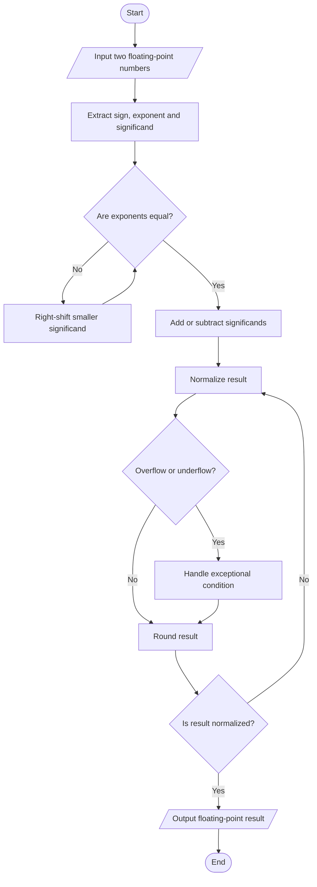

### 16.3 Worked Example

Align the exponents:

```text
9.989×10^1 + 0.02377×10^1
```

The aligned smaller significand is `0.02377`. Adding the significands gives:

```text
9.989 + 0.02377 = 10.01277
```

Rounding to four significant digits gives `10.01`. Normalize:

```text
10.01 × 10^1 = 1.001 × 10^2
```

Final result (rounded to four significant digits):

```text
1.001 × 10^2
```

### 16.4 Floating-Point Addition Block Diagram

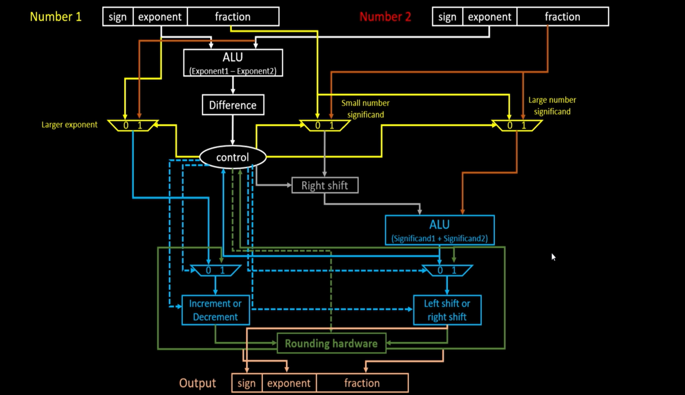

## 17. Floating-Point Multiplication Algorithm

Consider:

```text
9.989×10^{-5}
```

```text
2.377×10^9
```

### 17.1 Multiplication Algorithm

1. Extract the signs, exponents and significands of both operands.
2. Determine the sign of the result using the XOR of the operand signs.
3. Calculate the new biased exponent:

```text
E=E_1+E_2-Bias
```

4. Multiply the two significands.
5. Normalize the product.
6. If normalization requires shifting, adjust the exponent accordingly.
7. Check for overflow or underflow.
8. Round the significand to the available precision.
9. Verify that the result is normalized.
10. Pack the sign, exponent and fraction into the final floating-point result.

### 17.2 Floating-Point Multiplication Flowchart

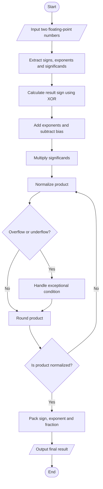

### 17.3 Worked Binary Example

Consider:

```text
1.000_2×2^{-1}
```

and

```text
-1.010_2×2^{-1}
```

For single precision, the biased exponents are:

```text
E_1=-1+127=126
```

```text
E_2=-1+127=126
```

The new biased exponent is:

```text
E=126+126-127=125
```

The actual exponent is:

```text
125-127=-2
```

Multiply the significands:

```text
1.000_2×1.010_2=1.010_2
```

The signs are different, so the result is negative.

Final result:

```text
-1.010_2×2^{-2
```

---

## 18. Key Learning Outcomes

1. Understood function calling conventions and register usage in RISC-V.
2. Learned the role of the stack pointer and memory allocation during function calls.
3. Studied JAL, JALR, LUI and AUIPC instructions.
4. Analyzed the assembly execution of main, scanf, printf and leaf_proc.
5. Understood signed integer overflow in addition and subtraction.
6. Studied all six RISC-V base integer instruction formats.
7. Understood binary multiplication and division algorithms.
8. Learned RV64M multiplication instructions.
9. Studied IEEE 754 single- and double-precision floating-point representations.
10. Understood normalized and subnormal floating-point numbers.
11. Learned biased exponent representation.
12. Studied floating-point addition and multiplication algorithms.

---

**Workshop:** RISC-V Based MYTH Workshop  
**Program:** SFAL – Women in Semiconductor Program  
**Day:** 02  
**Topics:** ABI, Memory Allocation, Stack Pointer, Overflow Conditions, RV64M, RV64F and RV64D

