# Day 03 – Digital Logic Design Using TL-Verilog

**Workshop:** RISC-V Based MYTH Workshop  
**Instructor:** Steve Hoover – Founder, Redwood EDA  
**Platform:** [Makerchip IDE](https://makerchip.com/)  
**HDL:** Transaction-Level Verilog (TL-Verilog)

---

## 1. Overview

Day 3 focuses on the fundamentals of digital logic design and the implementation of combinational, sequential, and pipelined circuits using Transaction-Level Verilog (TL-Verilog).

The objective is to understand how individual logic gates can be combined to construct complex digital systems and how these concepts form the foundation of processor architecture.

The session introduces the Makerchip online IDE, where hardware designs can be written, compiled, simulated, and analyzed using waveform and automatically generated pipeline diagrams.

The workshop progresses through the following concepts:

- Fundamental logic gates and Boolean algebra
- Combinational circuit design
- Arithmetic circuits and multiplexers
- Sequential logic and flip-flops
- Pipeline stages and retiming
- High-frequency design using pipelining
- Validity-based pipeline control
- Clock gating concepts
- Hierarchical design and hardware replication

## 2. Digital Logic Fundamentals

Digital circuits operate on binary values, represented by logic 0 and logic 1. Logic gates are the fundamental building blocks used to construct these circuits.

### 2.1 Logic Gates and Truth Tables

The seven fundamental logic gates are AND, OR, NOT, NAND, NOR, XOR, and XNOR.

| Gate | Boolean expression | Function |
|---|---|---|
| AND | Y = A · B | Output is HIGH when both inputs are HIGH |
| OR | Y = A + B | Output is HIGH when at least one input is HIGH |
| NOT | Y = A' | Produces the complement of the input |
| NAND | Y = (A · B)' | Complement of AND |
| NOR | Y = (A + B)' | Complement of OR |
| XOR | Y = A ⊕ B | Output is HIGH when inputs differ |
| XNOR | Y = (A ⊕ B)' | Output is HIGH when inputs are equal |

**Combined truth table**

| A | B | AND | OR | NAND | NOR | XOR | XNOR |
|---|---|---|---|---|---|---|---|
| 0 | 0 | 0 | 0 | 1 | 1 | 0 | 1 |
| 0 | 1 | 0 | 1 | 1 | 0 | 1 | 0 |
| 1 | 0 | 0 | 1 | 1 | 0 | 1 | 0 |
| 1 | 1 | 1 | 1 | 0 | 0 | 0 | 1 |

**NOT gate**

| A | NOT A |
|---|---|
| 0 | 1 |
| 1 | 0 |

### 2.2 Boolean Operators and Verilog Notation

Boolean expressions can be represented in hardware description languages using logical and bitwise operators.

| Operation | Boolean notation | Verilog operator | Example |
|---|---|---|---|
| Bitwise AND | A · B | `&` | `A & B` |
| Bitwise OR | A + B | `\|` | `A \| B` |
| Bitwise NOT | A' | `~` | `~A` |
| XOR | A ⊕ B | `^` | `A ^ B` |
| XNOR | (A ⊕ B)' | `~^` | `A ~^ B` |
| Logical AND | – | `&&` | `A && B` |
| Logical OR | – | `\|\|` | `A \|\| B` |
| Logical NOT | – | `!` | `!A` |
| Equality | – | `==` | `A == B` |
| Conditional selection | – | `?:` | `S ? A : B` |

**Bitwise vs. logical operations**

- Bitwise operators perform operations on corresponding bits of vectors.
- Logical operators evaluate expressions as Boolean conditions and return a single Boolean result.

These operators are essential for describing combinational and sequential hardware.

## 3. Combinational Circuit Design

A combinational circuit is a digital circuit in which the output depends only on the current input values.

It does not retain previous states and does not require a clock for its logical operation.

Examples include adders, multiplexers, encoders, decoders, and comparators.

### 3.1 Full Adder

A full adder is a combinational arithmetic circuit that adds three one-bit inputs:

- A – First operand
- B – Second operand
- Cin – Carry input

It produces two outputs:

- Sum – Result bit
- Cout – Carry output

**Truth table**

| A | B | Cin | Sum | Cout |
|---|---|---|---|---|
| 0 | 0 | 0 | 0 | 0 |
| 0 | 0 | 1 | 1 | 0 |
| 0 | 1 | 0 | 1 | 0 |
| 0 | 1 | 1 | 0 | 1 |
| 1 | 0 | 0 | 1 | 0 |
| 1 | 0 | 1 | 0 | 1 |
| 1 | 1 | 0 | 0 | 1 |
| 1 | 1 | 1 | 1 | 1 |

**Boolean equations**

```verilog
Sum  = A ^ B ^ Cin;
Cout = (A & B) | (B & Cin) | (A & Cin);
```

**Multi-bit adder implementation**

Multiple full adders can be cascaded to construct a multi-bit ripple-carry adder.

The carry output of each stage is connected to the carry input of the next stage.

For example, four cascaded full adders form a 4-bit ripple-carry adder.

This demonstrates how simple combinational building blocks can be interconnected to implement larger arithmetic operations.

### 3.2 Multiplexer (MUX)

A multiplexer is a combinational circuit that selects one input from multiple input signals based on a select signal.

For a 2:1 multiplexer:

- Inputs: X1 and X2
- Select: S
- Output: F

**Truth table**

| S | Output |
|---|---|
| 0 | X2 |
| 1 | X1 |

**Boolean expression**

```verilog
F = (S & X1) | (~S & X2);
```

A 2:1 multiplexer can therefore be implemented using two AND gates, one NOT gate, and one OR gate.

**TL-Verilog implementation**

```tlv
$out = $sel ? $in1 : $in2;
```

The ternary operator selects `$in1` when `$sel` is HIGH and `$in2` when `$sel` is LOW.

Larger multiplexers can be constructed by combining smaller multiplexers.

Selection can also be implemented using one-hot control signals, where only one select bit is active at a time, or using priority-based conditional expressions when multiple conditions may be active.

---

## 4. Makerchip IDE – Initial Setup

Makerchip is an online hardware design and simulation platform used throughout the workshop.

It provides an integrated environment for writing TL-Verilog, compiling designs, analyzing simulation waveforms, and viewing automatically generated pipeline diagrams.

The initial exercise involved opening the Makerchip IDE, executing the provided Pythagoras example, and exploring the editor, waveform viewer, diagram, and compilation log.

**Screenshot – Makerchip IDE**

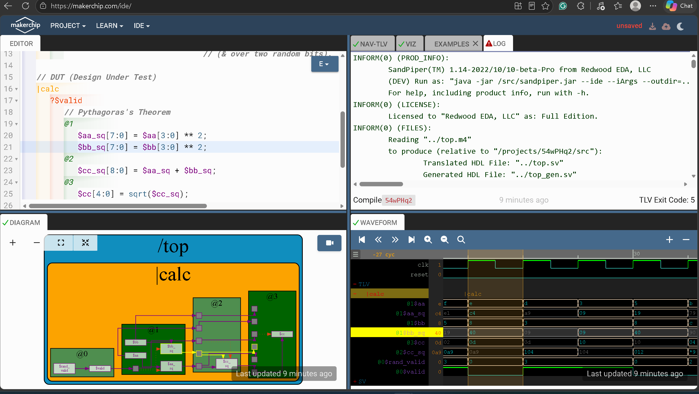

*Initial Makerchip environment with the Pythagoras example, source code, waveform, diagram, and compilation log.*

---

## 5. Combinational Logic Implementation in TL-Verilog

### 5.1 Basic Logic Operations – 

TL-Verilog simplifies signal declaration and connectivity compared with conventional RTL coding.

Signals are represented using the `$` prefix. In the Makerchip environment, the basic combinational examples can be implemented directly without explicitly declaring traditional module input and output ports.

**Implementation**

```tlv
$out = !$in1;               // NOT
$out = $in1 && $in2;        // Logical AND
$out = $in1 || $in2;        // Logical OR
$out = $in1 ^ $in2;         // XOR
```

These expressions demonstrate the implementation of basic Boolean operations using TL-Verilog.

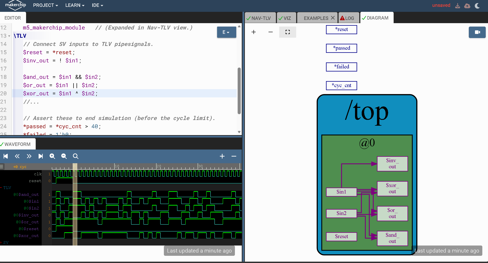

### 5.2 Vector Operations 

A vector is a collection of multiple bits treated as a single signal.

TL-Verilog supports arithmetic and logical operations directly on vector signals.

**Implementation**

```tlv
$out[4:0] = $in1[3:0] + $in2[3:0];
```

**Signal interpretation**

| Signal | Width | Description |
|---|---:|---|
| `$in1[3:0]` | 4 bits | First operand |
| `$in2[3:0]` | 4 bits | Second operand |
| `$out[4:0]` | 5 bits | Addition result |

A 5-bit output is used to accommodate a possible carry generated while adding two 4-bit unsigned operands.

In Makerchip, signal widths are specified to define the stimulus and expected signal representation.

After writing the implementation, pressing **E** compiles and executes the design. The generated waveform can then be inspected without manually creating a separate testbench for these basic exercises.

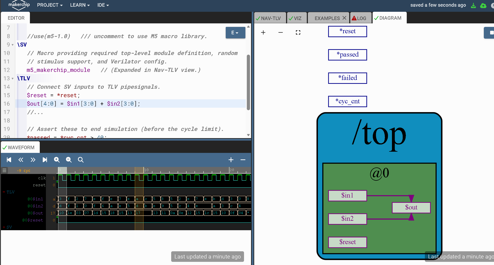

### 5.3 Multiplexer Implementation 

The 2:1 multiplexer discussed earlier is implemented in TL-Verilog using a conditional expression.

```tlv
$out = $sel ? $in1 : $in2;
```

The expression implements input selection based on the value of `$sel`.

- `$sel = 1`: Output receives `$in1`.
- `$sel = 0`: Output receives `$in2`.

This provides a compact representation of the multiplexer functionality.

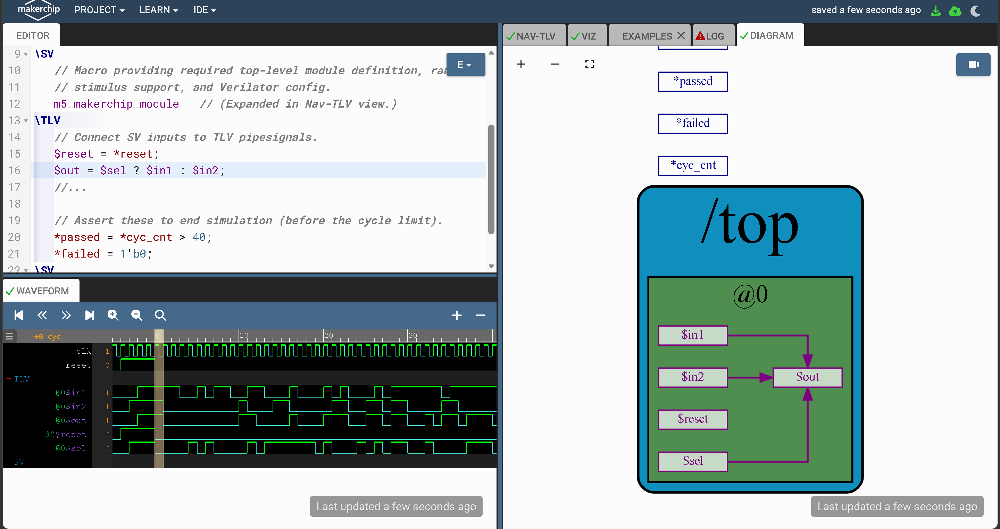

### 5.4 Combinational Calculator

A combinational calculator was implemented to perform four arithmetic operations:

1. Addition
2. Subtraction
3. Multiplication
4. Division

The operation is selected using a 2-bit opcode.

**TL-Verilog implementation**

```tlv
|calc
   @1
      $reset = *reset;

      $val1[31:0] = $rand1[3:0];
      $val2[31:0] = $rand2[3:0];
      $op[1:0]    = $rand3[1:0];

      $sum[31:0]  = $val1 + $val2;
      $diff[31:0] = $val1 - $val2;
      $prod[31:0] = $val1 * $val2;
      $qout[31:0] = ($val2 != 0) ?
                     ($val1 / $val2) : 32'hDEAD_BEEF;

      $out[31:0] = ($op[1:0] == 2'b00) ? $sum  :
                   ($op[1:0] == 2'b01) ? $diff :
                   ($op[1:0] == 2'b10) ? $prod :
                                          $qout;
```

**Opcode mapping**

| Opcode | Operation |
|---|---|
| `2'b00` | Addition |
| `2'b01` | Subtraction |
| `2'b10` | Multiplication |
| `2'b11` | Division |

The arithmetic results are computed in parallel, and the opcode-controlled conditional expression selects the required result.

The division operation includes a zero-divisor check. If the divisor is zero, the output is assigned `32'hDEAD_BEEF` instead of performing the division.

**Observation:** This implementation demonstrates how arithmetic operators and conditional selection can be combined to construct a simple combinational datapath.

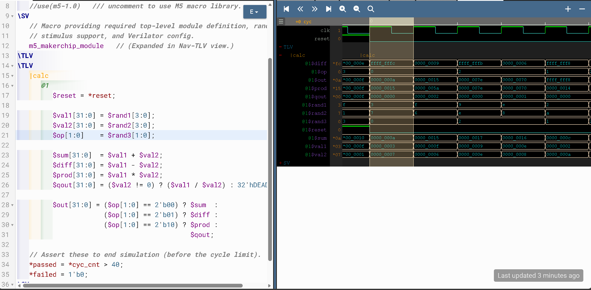

---

## 6. Sequential Logic

Sequential circuits differ from combinational circuits because their outputs depend on both current inputs and previously stored values.

They use storage elements such as flip-flops to retain state between clock cycles.

### 6.1 Clock and Flip-Flops

A flip-flop stores one bit of information and updates its state at a specified clock edge.

In the examples discussed, the positive edge of the clock is used to capture and propagate new values.

The clock synchronizes the operations performed by different parts of the circuit.

**Reset operation**

A reset signal initializes the circuit to a known state.

Without proper initialization, storage elements may begin with unknown or uninitialized values.

In TL-Verilog, reset conditions can be incorporated directly into signal assignments.

### 6.2 Fibonacci Sequence 

The Fibonacci sequence is used to demonstrate sequential data dependencies.

Each new Fibonacci number is generated by adding the two preceding numbers.

Mathematically:

```text
F(n) = F(n-1) + F(n-2)
```

**TL-Verilog implementation**

```tlv
$num[31:0] = $reset ? 1 : (>>1$num + >>2$num);
```

**Understanding the implementation**

| Expression | Description |
|---|---|
| `$num[31:0]` | 32-bit pipeline signal |
| `$reset` | Reset condition |
| `>>1$num` | Value of `$num` from one cycle earlier |
| `>>2$num` | Value of `$num` from two cycles earlier |
| `?:` | Conditional selection operator |

When reset is asserted, the signal is initialized to 1.

Otherwise, the current value is generated by adding the values from the previous two cycles.

The `>>` notation is used in TL-Verilog to reference earlier pipeline values, allowing sequential dependencies to be expressed without manually instantiating each intermediate register.

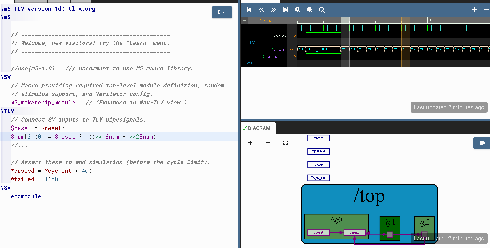

### 6.3 Counter Circuit

A counter is a basic sequential circuit that increments its stored value on successive clock cycles.

**Implementation**

```tlv
$num[31:0] = $reset ? 0 : (>>1$num + 1);
```

**Operation**

1. When reset is asserted, the counter is initialized to zero.
2. Otherwise, the previous cycle's value is incremented by one.
3. The updated value is retained for the next cycle.

This example demonstrates feedback through sequential state.

### 6.4 Sequential Calculator 

The combinational calculator was modified to introduce sequential behavior.

The primary modification is that the first operand is obtained from the previous cycle's output.

```tlv
$val1[31:0] = >>1$out;
$val2[31:0] = $rand2[3:0];
$op[1:0]    = $rand3[1:0];
```

The arithmetic operations remain:

```tlv
$sum[31:0]  = $val1 + $val2;
$diff[31:0] = $val1 - $val2;
$prod[31:0] = $val1 * $val2;
$qout[31:0] = ($val2 != 0) ?
               ($val1 / $val2) : 32'hDEAD_BEEF;
```

The output selection is additionally controlled using reset.

This modification introduces feedback from the previous output, making the calculator sequential.

**Key observation:** The design demonstrates how the result of one clock cycle can become an input to the next cycle.

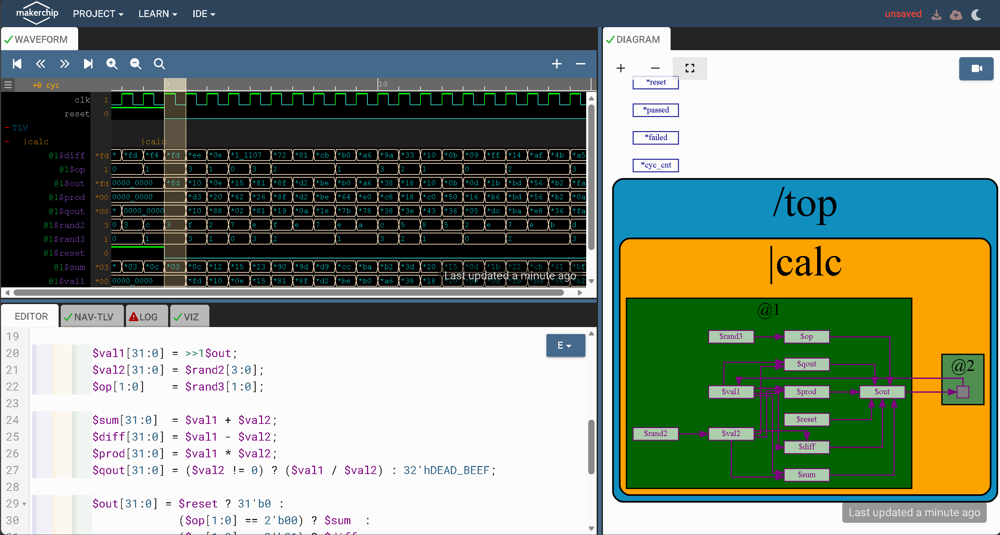

---

## 7. Pipelined Logic

### 7.1 Introduction to Pipelining

Pipelining is a technique in which a complex operation is divided into multiple smaller stages.

Instead of performing all operations within a single clock cycle, intermediate results are captured between stages using pipeline registers.

This reduces the amount of combinational logic that must be completed within one clock period.

The primary benefits are:

- Improved operating frequency potential.
- Increased transaction throughput.
- Better utilization of hardware across multiple transactions.
- Reduced combinational delay per pipeline stage.

### 7.2 Pythagoras Pipeline 

The Pythagoras theorem is used to demonstrate the implementation of a multi-stage pipeline.

The mathematical expression is:

```text
c = sqrt(a² + b²)
```

The calculation is divided into three stages.

| Pipeline stage | Operation |
|---|---|
| Stage 1 | Calculate a² and b² |
| Stage 2 | Add the squared values |
| Stage 3 | Calculate the square root |

**Pipeline operation**

- Stage 1 computes the squares of both inputs.
- Stage 2 adds the intermediate results.
- Stage 3 calculates the final square root.

The intermediate results are transferred between stages using pipeline registers.

**RTL view and Timing Abstract view**

The workshop demonstrated two ways of understanding the pipeline:

- **RTL view:** Represents the logic and register structure.
- **Timing Abstract view:** Represents the pipeline stages and the movement of signals through them.

TL-Verilog automatically handles the required inter-stage connections based on the stage assignments.

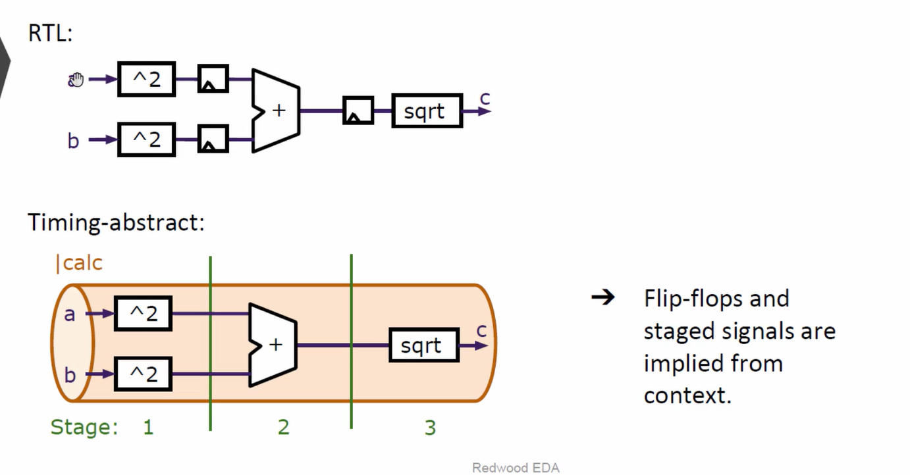

### 7.3 Pipeline Retiming

Pipeline retiming involves changing the placement of operations and registers across pipeline stages to modify the timing distribution of a design.

In TL-Verilog, stage assignments are explicitly represented using `@` notation.

For example:

```tlv
@1
   $aa_sq[31:0] = $aa * $aa;
```

The square operation is assigned to stage 1.

Changing stage assignments and adjusting the dependent expressions allows operations to be redistributed across stages.

In conventional RTL, similar modifications may require manually changing intermediate registers and signal connections.

TL-Verilog simplifies the process by expressing the intended timing of operations directly.

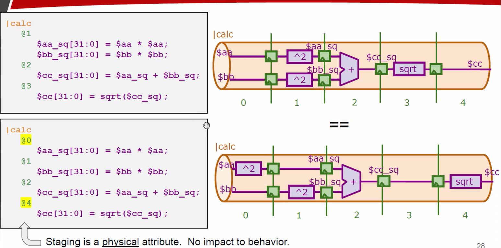

### 7.4 High-Frequency Design Using Pipelining

Consider the complete Pythagoras calculation:

```text
c = sqrt(a² + b²)
```

If all operations are performed in a single clock cycle, the circuit must complete:

1. Squaring the first input.
2. Squaring the second input.
3. Adding the squared values.
4. Computing the square root.

The total combinational delay can become large.

The clock period must be long enough to accommodate the complete critical path.

**Pipelined implementation**

The calculation is divided into separate stages:

| Stage | Operation |
|---|---|
| 1 | Calculate the squares |
| 2 | Add the squared values |
| 3 | Calculate the square root |

Pipeline registers separate these stages.

**Why does pipelining improve performance?**

The clock period is now determined by the delay of the slowest pipeline stage rather than the combined delay of all operations.

Once the pipeline is filled, different transactions can be processed simultaneously in different stages.

Example:

| Clock cycle | Stage 1 | Stage 2 | Stage 3 |
|---|---|---|---|
| 1 | A | – | – |
| 2 | B | A | – |
| 3 | C | B | A |
| 4 | D | C | B |

Here, transaction A progresses through the pipeline while subsequent transactions enter the earlier stages.

This overlapping execution increases throughput.

**Important design considerations**

- Pipelining can increase the maximum operating frequency.
- Throughput improves after the pipeline is filled.
- Latency may increase because the result passes through multiple stages.
- Additional pipeline registers introduce area and clock-power overhead.
- The slowest stage determines the achievable clock period.

Pipelining does not eliminate the computation time; it distributes the computation across clock cycles and enables overlapping execution.

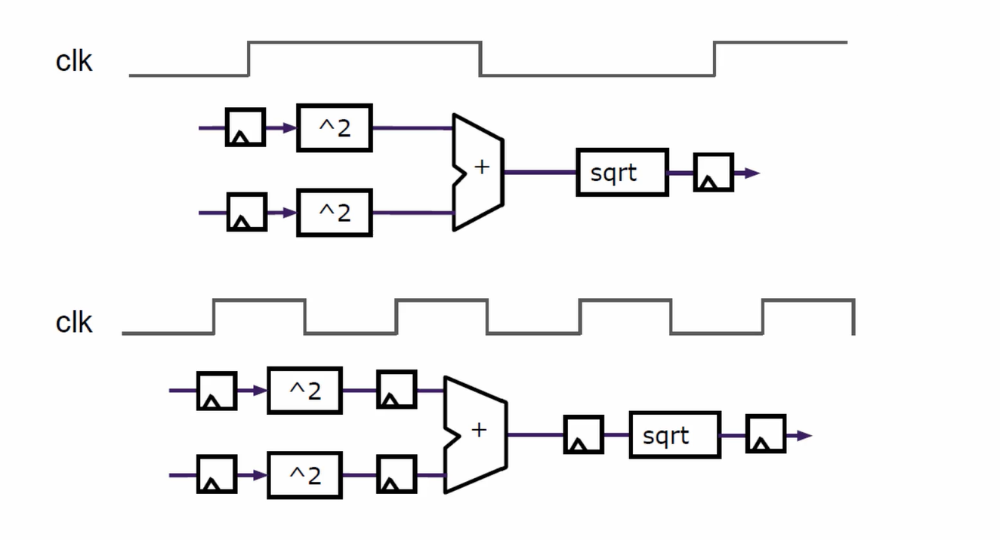

---

## 8. Pipeline Signals and Identifiers

TL-Verilog uses specific symbols and naming conventions to represent pipeline signals, scopes, and stage relationships.

| Notation | Description |
|---|---|
| `$signal` | Pipeline signal |
| `\|name` | Pipeline scope |
| `/name` | Hierarchical scope |
| `@n` | Pipeline stage |
| `?$valid` | Validity-based conditional scope |
| `*reset` | SystemVerilog interface signal |
| `>>1$signal` | Signal value from one cycle earlier |
| `>>2$signal` | Signal value from two cycles earlier |

The distinction between these notations is important when understanding signal flow, pipeline timing, and hierarchy.

### Pipeline Practice

A pipeline diagram was reproduced using the Makerchip environment.

The exercise involved identifying the pipeline structure and observing how signals are represented across different stages.

The reproduced diagram showed four unassigned values and six pipeline stages, matching the structure demonstrated during the workshop.

This exercise helped reinforce the relationship between pipeline stage declarations and the automatically generated NAV-TLV diagram.

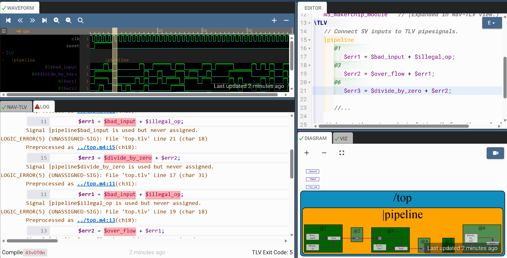

---

## 9. Integrating Counter and Calculator Pipeline

The earlier counter and calculator examples were extended into a combined pipeline exercise.

This implementation brings together:

- Sequential state
- Arithmetic operations
- Pipeline stages
- Counter logic
- Signal dependencies
- Waveform analysis

The objective was to understand how multiple logic operations can be organized within a pipelined design.

The Makerchip waveform and diagram provide visibility into the movement of values across clock cycles.

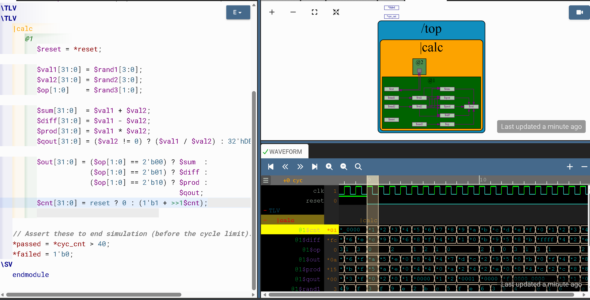

---

## 10. Two-Cycle Calculator

For high-frequency designs, it may be beneficial to distribute the calculator operations across multiple stages.

In this exercise, the calculator is divided into two stages.

**Stage 1**

- Obtain the operands.
- Perform addition.
- Perform subtraction.
- Perform multiplication.
- Perform division.

**Stage 2**

- Select the required arithmetic result based on the opcode.
- Generate the final output.

**TL-Verilog implementation**

```tlv
|calc
   @1
      $reset = *reset;

      $val1[31:0] = >>2$out;
      $val2[31:0] = $rand2[3:0];
      $op[1:0]    = $rand3[1:0];

      $sum[31:0]  = $val1 + $val2;
      $diff[31:0] = $val1 - $val2;
      $prod[31:0] = $val1 * $val2;
      $qout[31:0] = ($val2 != 0) ?
                     ($val1 / $val2) : 32'hDEAD_BEEF;

      $valid = $reset ? 0 : (1'b1 + >>1$valid);

   @2
      $cal[31:0] = ($op[1:0] == 2'b00) ? $sum  :
                   ($op[1:0] == 2'b01) ? $diff :
                   ($op[1:0] == 2'b10) ? $prod :
                                          $qout;

      $out = (!$valid || $reset) ? 32'b0 : $cal;
```

The arithmetic operations are described in stage 1, while the result selection and output generation are described in stage 2.

The `$valid` signal is introduced to track whether the pipeline contains a meaningful transaction.

The example also demonstrates the use of `>>2$out` to reference an earlier output value.

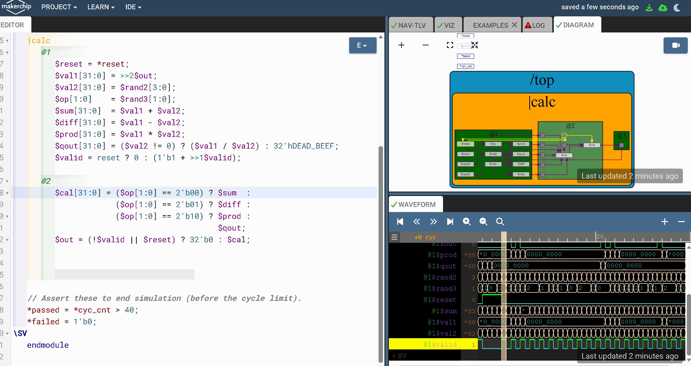

---

## 11. Validity in TL-Verilog

Validity is an important concept in transaction-level hardware design.

It indicates whether a particular pipeline transaction contains meaningful data.

Unlike conventional RTL, TL-Verilog provides a dedicated validity-based conditional scope.

**Syntax**

```tlv
?$valid
   @1
      // Logic for valid transactions
```

When `$valid` is asserted, the logic inside the scope is considered active for a valid transaction.

When validity is deasserted, the associated pipeline data can be treated as don't-care values, subject to the design's validity and dependency rules.

### 11.1 Advantages of Validity

- Identifies meaningful transactions.
- Simplifies pipeline control.
- Improves design readability.
- Helps avoid treating invalid data as meaningful results.
- Supports optimization by identifying unnecessary computations.

### 11.2 Validity and Clock Gating

Clock gating is a low-power design technique used to reduce unnecessary clock switching activity.

The clock signal is distributed throughout a synchronous design to drive flip-flops and other sequential elements.

Clock transitions contribute to dynamic power consumption because of the switching activity associated with the clock network.

If a register does not need to update, unnecessary clock transitions can be avoided through appropriate clock-gating logic.

**Relationship with validity**

Validity information can help identify when pipeline data needs to be processed or captured.

This information can be used as part of the control conditions for clock gating and other power optimizations.

**Important distinction:**

- Validity identifies whether a transaction contains meaningful data.
- Clock gating controls whether the clock is delivered to a sequential element or group of elements.

Validity does not automatically imply that the clock is gated. Actual clock gating requires suitable clock-control structures and implementation support.

TL-Verilog's validity methodology makes it easier to express conditions that can support fine-grained power optimization.

---

## 12. Pythagoras Pipeline with Validity 

The Pythagoras pipeline was extended by introducing a validity condition.

This exercise combines pipeline stages, reset handling, validity, and accumulation of results.

### 12.1 SystemVerilog and TL-Verilog Sections

The source file contains multiple sections.

**TL-Verilog version declaration**

```tlv
\m5_TLV_version 1d: tl-x.org
```

Specifies the TL-Verilog version information used by the Makerchip environment.

**SystemVerilog section**

```verilog
\SV
   `include "sqrt32.v";
   m4_include_lib(https://raw.githubusercontent.com/stevehoover/makerchip_examples/refs/heads/master/pythagoras_viz.tlv)

   m5_makerchip_module
```

The `\SV` section allows conventional SystemVerilog declarations, module infrastructure, and external includes to be used alongside TL-Verilog.

- `sqrt32.v` provides the square-root implementation.
- `m4_include_lib` includes the external Pythagoras visualization and logging library.
- `m5_makerchip_module` provides the Makerchip module infrastructure.

**TL-Verilog section**

```tlv
\TLV
```

Contains the actual TL-Verilog design and pipeline logic.

### 12.2 Reset Signal Mapping

```tlv
$reset = *reset;
```

Here:

- `$reset` is a TL-Verilog pipeline signal.
- `*reset` refers to the reset signal provided through the SystemVerilog interface.

The assignment connects the external reset input to the TL-Verilog design.

### 12.3 Pythagoras Pipeline Implementation

```tlv
|calc
   ?$valid
      @1
         $aa_sq[7:0] = $aa[3:0] ** 2;
         $bb_sq[7:0] = $bb[3:0] ** 2;

      @2
         $cc_sq[8:0] = $aa_sq + $bb_sq;

      @3
         $cc[4:0] = sqrt($cc_sq);
```

The calculation is divided into three pipeline stages.

| Stage | Operation |
|---|---|
| `@1` | Calculate the squares of the two inputs |
| `@2` | Add the squared values |
| `@3` | Calculate the square root |

The validity scope ensures that the calculation is associated with valid transactions.

### 12.4 Accumulating the Result

```tlv
@4
   $tot_dist[63:0] = $reset ? '0 :
                     $valid ? >>1$tot_dist + $cc :
                              $RETAIN;
```

The final stage maintains an accumulated distance.

- During reset, the accumulator is initialized to zero.
- For a valid transaction, the previous accumulated value is added to the new distance.
- Otherwise, `$RETAIN` preserves the previous state.

This demonstrates the combination of pipelined computation and sequential state retention.

### 12.5 Visualization and Logging

```tlv
m5+pythagorean_viz_and_log(1)
```

This macro invokes the Pythagoras visualization and logging functionality included through the external library.

It allows the calculation to be observed through the Makerchip visualization and log facilities.

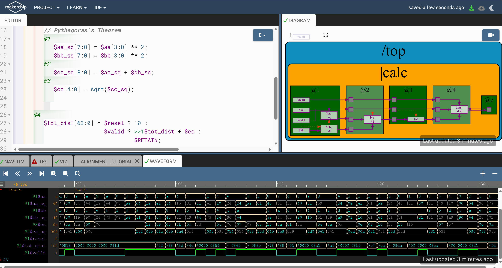

---

## 13. Two-Cycle Calculator with Validity 

The two-cycle calculator was further extended using validity-based pipeline control.

The objective is to ensure that the output is treated as meaningful only when the corresponding transaction has progressed through the pipeline.

This exercise demonstrates the combination of:

- Two-stage calculator architecture.
- Arithmetic result generation.
- Opcode-based result selection.
- Validity propagation.
- Reset handling.
- Pipeline output control.

The validity signal provides a way to distinguish valid transactions from inactive pipeline cycles.

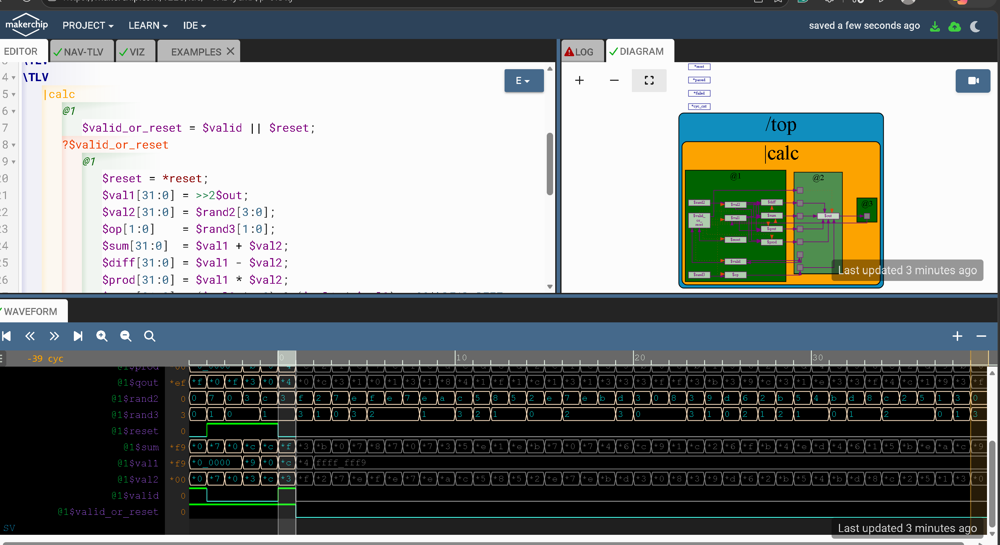

---

## 14. Makerchip Visualization – VIZ Tab

Makerchip provides multiple views for understanding a hardware design.

The NAV-TLV diagram is generated automatically based on the pipeline scopes, stage assignments, and signal dependencies.

The VIZ tab provides a separate graphical visualization of the design.

Unlike the NAV-TLV diagram, the VIZ tab requires visualization code to be included in the source.

### 14.1 The `\viz_js` Block

`\viz_js` is a JavaScript-based visualization block that uses the Fabric.js drawing library.

It allows the designer to create graphical representations of the hardware simulation.

The visualization can display signal values, text, graphical objects, and other information that updates during simulation.

### 14.2 Components of a Visualization Block

| Component | Purpose |
|---|---|
| `box` | Defines the visualization area and appearance |
| `init()` | Initializes graphical objects |
| `render()` | Updates graphical objects during simulation |
| `where` | Defines the position of the visualization relative to its parent |

### 14.3 Accessing Signal Values

The visualization block provides methods to read simulation signals.

```javascript
'$out'.asInt()       // Read signal as an integer
'$valid'.asBool()    // Read signal as a Boolean
'$out'.asHexStr()    // Read signal as hexadecimal
```

Signals from previous stages can also be accessed using stage references.

```javascript
'>>1$out'
```

### 14.4 Calculator Visualization Example

```tlv
@2
   $out[31:0] = ...;

   \viz_js
      box: {width: 260, height: 110, fill: "#fcf5ee", stroke: "gray"},
      init() {
         return {
            txt: new fabric.Text("", {
               left: 10, top: 10,
               fontSize: 16, fontFamily: "Courier New",
            })
         }
      },
      render() {
         this.obj.txt.set({text:
            "val1: " + '$val1'.asInt() + "\n" +
            "val2: " + '$val2'.asInt() + "\n" +
            "op:   " + '$op'.asInt() + "\n" +
            "out:  " + '$out'.asInt()
         })
         return []
      },
```

### 14.5 Steps to Enable Visualization

1. Complete the TL-Verilog implementation.
2. Compile the design and verify that the log does not contain errors.
3. Add the `\viz_js` block at the appropriate scope and indentation.
4. Compile the design again.
5. Open the VIZ tab.
6. Step through the simulation and observe the changing signal values.

**Common issue:** If the VIZ tab displays "This model has no visualization", check whether the design contains a valid `\viz_js` block.

---

## 15. Hierarchical Design in TL-Verilog 

Hierarchy is used to organize a complex hardware design into smaller, logically related sections.

It allows repeated hardware structures to be represented efficiently without duplicating the same implementation.

In TL-Verilog, hierarchical scopes are represented using the `/` prefix, while pipeline scopes and timing stages are represented using `|` and `@` respectively.

### 15.1 Scope Types

| Notation | Description | Purpose |
|---|---|---|
| `\|name` | Pipeline scope | Defines a pipeline |
| `/name` | Hierarchical scope | Groups and organizes hardware |
| `@n` | Pipeline stage | Specifies the timing stage |

### 15.2 Example – Distance Calculation

Consider the calculation of the distance from the origin using the Pythagoras theorem:

```text
Distance = sqrt(x² + y²)
```

Instead of writing separate logic for each coordinate, hierarchical replication allows the same logic to be instantiated for multiple coordinates.

**TL-Verilog implementation**

```tlv
\TLV
   |calc
      /coord[1:0]
         @1
            $sq[9:0] = $value[3:0] ** 2;

      @2
         $cc_sq[10:0] = /coord[0]$sq + /coord[1]$sq;

      @3
         $cc[4:0] = sqrt($cc_sq);
```

### 15.3 Understanding Hierarchical Replication

```tlv
/coord[1:0]
```

This creates two instances:

```text
/coord[0]
/coord[1]
```

Each instance contains its own `$value` and `$sq` signals and performs the same squaring operation independently.

This is conceptually similar to an array of module instances or a Verilog generate construct.

The number of replicated instances can be changed by modifying the range.

For example:

```tlv
/coord[7:0]
```

creates eight coordinate instances.

### 15.4 Accessing Signals Across Hierarchical Scopes

Within a hierarchical scope, signals can be referenced directly.

```tlv
$sq
```

To access a signal from another scope, the hierarchical path is used.

```tlv
/coord[0]$sq
/coord[1]$sq
```

This allows signals from different replicated instances to be accessed and combined.

### 15.5 Hierarchy and Pipeline Timing

Hierarchy and pipeline stages describe two different aspects of a hardware design.

- **Hierarchy:** Defines how hardware is grouped and organized.
- **Pipeline stages:** Define when operations take place.

In the example:

| Stage | Operation |
|---|---|
| `@1` | Each coordinate calculates its square |
| `@2` | The squared values are added |
| `@3` | Square root is calculated |

The required pipeline connections are inferred from the stage assignments and signal dependencies.

### 15.6 Benefits of Hierarchical Design

- Reduces repetitive code.
- Supports scalable hardware replication.
- Organizes related signals into logical groups.
- Simplifies complex design structures.
- Improves code readability and maintainability.

These concepts become especially useful when designing larger processor architectures containing repeated execution units, register structures, and functional blocks.

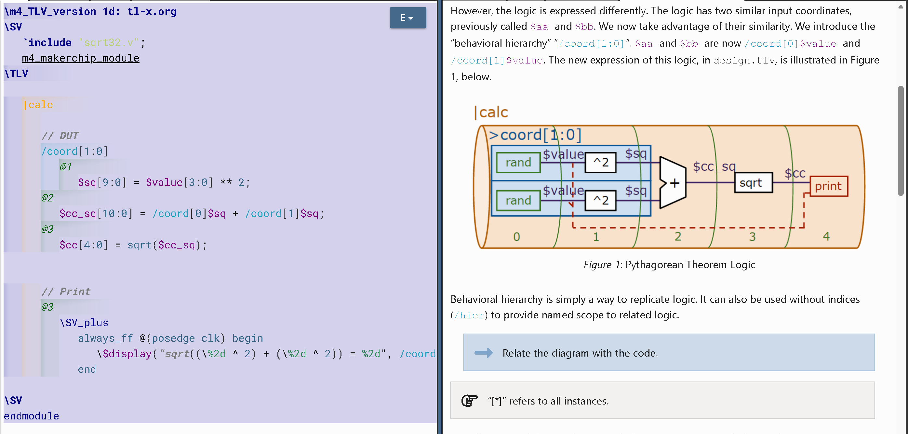

---

## 16. Key Takeaways

The Day 3 workshop covered the transition from fundamental digital logic to more structured hardware design using TL-Verilog.

The major concepts explored were:

| Area | Concepts learned |
|---|---|
| Digital Logic | Logic gates, truth tables, Boolean operators |
| Combinational Logic | Full adders, multiplexers, vector operations |
| Arithmetic Design | Addition, subtraction, multiplication, division |
| Sequential Logic | Clock, flip-flops, reset, feedback |
| Sequential Examples | Fibonacci sequence and counters |
| Pipelining | Pipeline stages, registers, retiming |
| Performance | Throughput, latency and clock frequency |
| Pipeline Control | Validity and transaction management |
| Power Optimization | Clock gating concepts |
| Visualization | Waveforms, NAV-TLV and VIZ |
| Hierarchical Design | Scope creation and hardware replication |

## 17. Conclusion

Day 3 provided practical exposure to the methodology of digital hardware design using TL-Verilog and Makerchip.

Starting from fundamental logic gates, the workshop progressively introduced combinational circuits, sequential behavior, pipelined computation, validity-based control, and hierarchical hardware organization.

An important takeaway was understanding how TL-Verilog simplifies pipeline description by allowing operations to be assigned directly to stages, reducing the need for manually connecting intermediate registers.

The concepts covered in this session establish the foundation for understanding datapath construction, control logic, and pipeline organization in a RISC-V processor.

---
