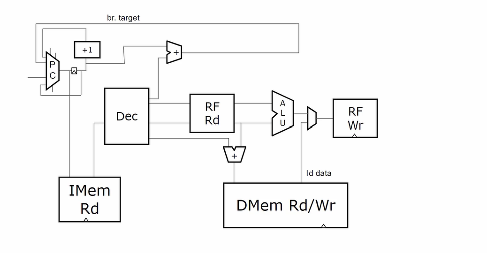
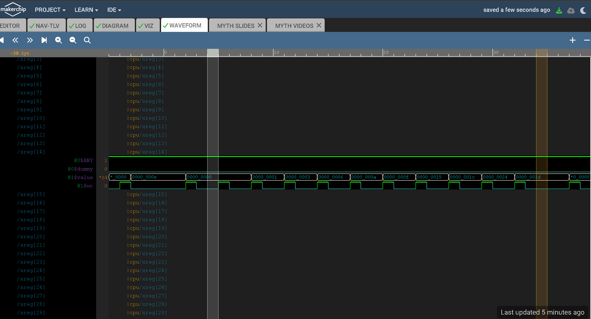
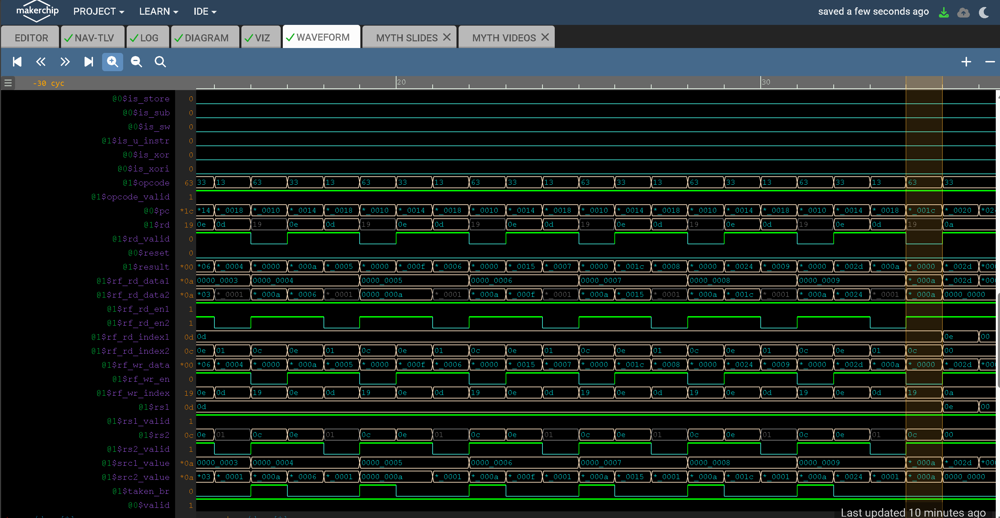
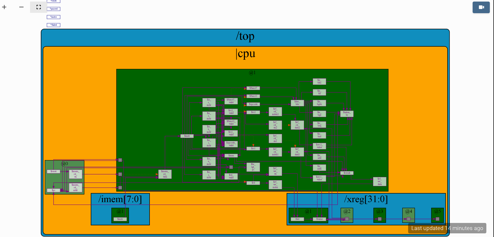

# Day 4 – Building a Simple RISC-V Processor Using TL-Verilog

## 1. Objective

Day 4 of the RISC-V MYTH Workshop focused on understanding the internal architecture of a RISC-V processor and implementing a basic RV32I instruction subset using TL-Verilog in Makerchip.

The objective was to understand how an instruction travels through the processor, beginning with instruction fetch and continuing through decoding, register-file access, execution and write-back. Conditional branching was subsequently introduced to enable changes in the normal program execution sequence.

The processor was developed incrementally. Each functional block was added to the TL-Verilog implementation and examined using Makerchip's simulation and waveform visualization features.

## 2. Workshop Agenda

The session covered the following topics:

1. Simple RISC-V processor subset
2. Pipelined RISC-V processor subset
3. Overview of the complete RV32I instruction set

The implementation in this documentation focuses on building and verifying the simple RV32I subset used in the workshop exercise.

## 3. Understanding the RISC-V Processor Architecture

Before implementing the processor, it is important to understand the role of each hardware component and how these components communicate.

A processor needs to fetch instructions, interpret them, obtain the required operands, execute operations and store the results.

The major components involved are:

| Component | Purpose |
|---|---|
| Program Counter (PC) | Holds the address of the instruction to be fetched |
| Instruction Memory (IMem) | Stores the instructions of the program |
| Instruction Decoder | Identifies the instruction type and extracts its fields |
| Register File (RF) | Stores register values and provides source operands |
| ALU | Performs arithmetic and logical operations |
| Data Memory (DMem) | Stores data used by load and store instructions |
| Adders | Calculate the next sequential PC and branch target address |

The overall instruction execution flow can be represented as:

```text
Program Counter
      |
      v
Instruction Memory
      |
      v
Instruction Decode
      |
      v
Register File Read
      |
      v
      ALU
      |
      v
Register File Write
```

Branch logic works alongside the execution path to determine whether the next instruction should be fetched sequentially or from a branch target address.



## 4. Processor Implementation Using TL-Verilog

The processor was implemented step by step. The initial exercise used a Sum of 1 to 9 program to test the processor.

The program performs the following operations:

- Initializes the registers.
- Maintains a counter.
- Adds the counter value to an intermediate sum.
- Increments the counter.
- Repeats the addition using a conditional branch.
- Stores the final result in register `a0` (x10).

The expected result is:

```text
1 + 2 + 3 + 4 + 5 + 6 + 7 + 8 + 9 = 45
```

The following sections explain how the processor was developed to execute this program.

### 4.1 Program Counter and Instruction Fetch

**Program Counter (PC)**

The Program Counter is responsible for maintaining the address of the instruction that must be executed next.

Since each instruction in this implementation is 32 bits (4 bytes), the PC normally advances by 4 to access the next sequential instruction.

During reset, the PC is initialized to zero. After reset is deasserted, the instruction memory read enable is activated.

```verilog
$reset = *reset;
$imem_rd_en = !$reset;

$pc[31:0] = >>1$reset ? 0 :
            (>>1$pc + 31'b100);

$imem_rd_addr[M4_IMEM_INDEX_CNT-1:0] =
    $pc[M4_IMEM_INDEX_CNT+1:2];
```

**Understanding the implementation**

- `$reset` receives the external reset signal.
- `$imem_rd_en` enables instruction-memory reads when the processor is not in reset.
- `$pc` holds the current instruction address.
- `31'b100` represents the value 4.
- The PC is incremented by 4 during sequential execution.
- `$imem_rd_addr` extracts the word-address portion of the byte-addressed PC.

The `>>1` notation in TL-Verilog refers to a value from the previous cycle. This is used to maintain the required timing relationship between the PC and reset signals.

**Simulation and waveform analysis**

Inspect the following signals:

- `reset`
- `pc`
- `imem_rd_en`
- `imem_rd_addr`

Expected behaviour:

1. During reset, the PC should be initialized to zero.
2. Once reset is deasserted, instruction-memory reads should be enabled.
3. During sequential execution, the PC should progress as 0, 4, 8, 12 and so on.
4. The instruction-memory address should correspond to the instruction addressed by the PC.

This verifies that the processor can generate the correct sequence of instruction addresses.

### 4.2 Instruction Fetch and Instruction-Type Identification

Once the instruction memory is enabled, the instruction is obtained through its read-data output.

```verilog
$instr[31:0] = $imem_rd_data[31:0];
```

Every instruction is 32 bits wide. However, the positions of the destination register, source registers and immediate fields differ depending on the instruction format.

Therefore, the processor must first identify the instruction type before extracting its fields.

The six basic instruction formats are:

- R-type – Register-register operations
- I-type – Immediate operations and loads
- S-type – Store operations
- B-type – Conditional branches
- U-type – Upper-immediate operations
- J-type – Jump operations

The instruction type is identified by examining bits `[6:2]` of the instruction.

```verilog
$is_i_instr = $instr[6:2] ==? 5'b0000x ||
              $instr[6:2] ==? 5'b001x0 ||
              $instr[6:2] ==? 5'b11001;

$is_r_instr = $instr[6:2] ==? 5'b01011 ||
              $instr[6:2] ==? 5'b011x0 ||
              $instr[6:2] ==? 5'b10100;

$is_s_instr = $instr[6:2] ==? 5'b0100x;
$is_b_instr = $instr[6:2] ==? 5'b11000;
$is_j_instr = $instr[6:2] ==? 5'b11011;
$is_u_instr = $instr[6:2] ==? 5'b0x101;
```

The `==?` operator is used for pattern matching, allowing `x` bits to represent don't-care positions.

**Simulation and waveform analysis**

Check the fetched instruction and the instruction-type signals together.

For each instruction, the corresponding type-identification signal should become active. For example, an ADD instruction should be identified as R-type, while ADDI should be identified as I-type.

This stage verifies that the processor can distinguish different instruction formats before decoding their operations.

### 4.3 Immediate Generation

Immediate values are constants encoded directly inside an instruction.

The immediate field does not occupy the same bit positions in every RISC-V instruction format. The processor must therefore reconstruct the immediate according to the identified instruction type.

The implementation is:

```verilog
$imm[31:0] = $is_i_instr ? {{21{$instr[31]}}, $instr[30:20]} :
             $is_s_instr ? {{21{$instr[31]}}, $instr[30:25], $instr[11:7]} :
             $is_b_instr ? {{20{$instr[31]}}, $instr[7],
                            $instr[30:25], $instr[11:8], 1'b0} :
             $is_u_instr ? {$instr[31:12], 12'b0} :
             $is_j_instr ? {{12{$instr[31]}}, $instr[19:12],
                            $instr[20], $instr[30:21], 1'b0} :
                           32'b0;
```

**Understanding the implementation**

- I-type: Extracts the 12-bit immediate and sign-extends it to 32 bits.
- S-type: Combines the immediate bits from `[31:25]` and `[11:7]`.
- B-type: Reconstructs the branch offset from its non-contiguous instruction bits.
- U-type: Places the 20-bit immediate in the upper 20 bits and appends 12 zeros.
- J-type: Reconstructs the jump offset from its non-contiguous instruction bits.

Sign extension preserves the signed value of an immediate when it is expanded to 32 bits.

For B-type and J-type instructions, the least significant bit is implicitly zero because their offsets are aligned.

**Simulation and waveform analysis**

Inspect `$imm` alongside `$instr` and the instruction-type signals.

Verify that:

- The immediate is reconstructed using the correct instruction bits.
- The sign bit is extended correctly for negative immediates.
- B-type and J-type offsets include the implicit zero bit.
- The U-type immediate has twelve zeros in its least significant positions.

This stage is particularly important because an incorrectly generated immediate can produce incorrect ALU results or branch addresses.

### 4.4 Instruction Field Extraction and Validity Checks

After identifying the instruction format, the processor extracts the individual fields from the 32-bit instruction.

```verilog
$opcode[6:0] = $instr[6:0];
$rd[4:0] = $instr[11:7];
$funct3[2:0] = $instr[14:12];
$rs1[4:0] = $instr[19:15];
$rs2[4:0] = $instr[24:20];
$funct7[6:0] = $instr[31:25];
```

These fields provide the information required by the decoder and register file.

| Field | Bit positions | Purpose |
|---|---|---|
| opcode | [6:0] | Identifies the general operation |
| rd | [11:7] | Destination register |
| funct3 | [14:12] | Further identifies the operation |
| rs1 | [19:15] | First source register |
| rs2 | [24:20] | Second source register |
| funct7 | [31:25] | Additional operation information |

Not every instruction format uses all these fields. For example, an ADDI instruction does not use `rs2`, while a U-type instruction does not use `rs1` or `rs2`.

Validity signals are therefore introduced to indicate which fields are meaningful for each instruction.

```verilog
$opcode_valid = $is_r_instr || $is_i_instr || $is_s_instr ||
                $is_b_instr || $is_u_instr || $is_j_instr;

$rd_valid = $is_r_instr || $is_i_instr ||
            $is_u_instr || $is_j_instr;

$funct3_valid = $is_r_instr || $is_i_instr ||
                $is_s_instr || $is_b_instr;

$rs1_valid = $is_r_instr || $is_i_instr ||
             $is_s_instr || $is_b_instr;

$rs2_valid = $is_r_instr || $is_s_instr || $is_b_instr;

$funct7_valid = $is_r_instr;
```

The corresponding conditional assignments ensure that a field is extracted only when it is valid.

For example:

```verilog
?$rd_valid
    $rd[4:0] = $instr[11:7];
```

**Simulation and waveform analysis**

Inspect the extracted fields and their validity signals.

The key observation is that the validity signals depend on the instruction format. For example:

- ADD uses `rd`, `rs1` and `rs2`.
- ADDI uses `rd` and `rs1`.
- A branch instruction uses `rs1` and `rs2`, but does not write to `rd`.

This prevents the processor from treating unused instruction bits as valid register addresses or operands.

### 4.5 Instruction Decoding

Instruction decoding determines the exact operation that the processor must perform.

The decoder uses the opcode, `funct3` and relevant `funct7` information to distinguish individual instructions.

```verilog
$dec_bits[10:0] = {$funct7[5], $funct3, $opcode};

$is_beq  = $dec_bits ==? 11'bx_000_1100011;
$is_bne  = $dec_bits ==? 11'bx_001_1100011;
$is_blt  = $dec_bits ==? 11'bx_100_1100011;
$is_bge  = $dec_bits ==? 11'bx_101_1100011;
$is_bltu = $dec_bits ==? 11'bx_110_1100011;
$is_bgeu = $dec_bits ==? 11'bx_111_1100011;

$is_addi = $dec_bits ==? 11'bx_000_0010011;
$is_add  = $dec_bits ==? 11'b0_000_0110011;
```

The branch instructions share the same opcode. Their `funct3` values distinguish the type of comparison to be performed.

Similarly, ADD and ADDI are distinguished using their opcode patterns.

The decoder identifies the operations needed by the Sum of 1 to 9 program, including ADD, ADDI and the conditional branch instructions.

**Simulation and waveform analysis**

Observe the decoded instruction signals as the program executes.

For example:

- When an ADD instruction is fetched, `$is_add` should be asserted.
- When an ADDI instruction is fetched, `$is_addi` should be asserted.
- When the BLT instruction is fetched, `$is_blt` should be asserted.

This confirms that the instruction fields are being interpreted correctly and that the processor can generate the appropriate control signals.

### 4.6 Register File Read

After decoding, the processor must obtain the values stored in the source registers.

The register file contains 32 general-purpose registers, each 32 bits wide in RV32I.

The source-register addresses extracted from the instruction are connected to the register-file read ports.

```verilog
$rf_rd_en1 = $rs1_valid;
$rf_rd_index1[4:0] = $rs1;

$rf_rd_en2 = $rs2_valid;
$rf_rd_index2[4:0] = $rs2;

$src1_value[31:0] = $rf_rd_data1;
$src2_value[31:0] = $rf_rd_data2;
```

There are two read ports:

- Read port 1 provides the value stored in `rs1`.
- Read port 2 provides the value stored in `rs2`.

The read enable signals are controlled by the validity of the source-register fields.

For instructions such as ADD, both source operands are required. For ADDI, only the first source register is required; the second operand comes from the immediate-generation logic.

**Understanding the register-file macro**

The MYTH workshop provides a register-file macro, so the internal register array does not need to be implemented manually.

Its interface includes:

| Signal | Purpose |
|---|---|
| `reset` | Reset control |
| `wr_en` | Write enable |
| `wr_index` | Destination register address |
| `wr_data` | Data to be written |
| `rd_en` | Read enable |
| `rd_index` | Source register address |
| `rd_data` | Read data output |

The macro handles the internal storage and read/write operations. In this exercise, the task is to connect the processor signals to the macro rather than build the register array from scratch.

**Simulation and waveform analysis**

Observe:

- Read enables for both ports.
- Read addresses corresponding to `rs1` and `rs2`.
- Read-data outputs.
- The source operand signals `$src1_value` and `$src2_value`.

The important check is whether the operand values supplied to the ALU match the contents of the selected registers.

### 4.7 ALU Operation

Once the source operands are available, the ALU performs the operation specified by the decoder.

For the current implementation, ADD and ADDI operations are supported.

```verilog
$result[31:0] = $is_addi ? $src1_value + $imm :
                $is_add  ? $src1_value + $src2_value :
                           32'bx;
```

**ADD instruction**

The ADD instruction performs register-register addition:

```text
result = rs1 + rs2
```

**ADDI instruction**

The ADDI instruction performs register-immediate addition:

```text
result = rs1 + immediate
```

The decoder selects the appropriate operands depending on the instruction.

In the Sum of 1 to 9 program, ADD is used to accumulate the intermediate sum, while ADDI is used to increment the counter.

**Simulation and waveform analysis**

Observe `$src1_value`, `$src2_value`, `$imm`, the decoded operation signals and `$result`.

For ADD, the result should equal the sum of the two register operands.

For ADDI, the result should equal the first register operand plus the immediate.

The ALU result should therefore reflect the arithmetic operation requested by the currently fetched instruction.

### 4.8 Register File Write-Back

After execution, the result must be stored in the destination register so that subsequent instructions can use it.

```verilog
$rf_wr_en = $rd_valid && $rd != 5'd0;
$rf_wr_index[4:0] = $rd;
$rf_wr_data[31:0] = $result;
```

The write enable is asserted only when:

1. The instruction has a valid destination register.
2. The destination register is not x0.

Register x0 is hardwired to zero in RISC-V and must not be modified.

The destination address is supplied through `$rf_wr_index`, and the ALU result is supplied through `$rf_wr_data`.

**Simulation and waveform analysis**

Observe the write enable, destination-register address and write data.

For instructions that produce a register result:

- Write enable should become active.
- The destination address should match `rd`.
- The write data should match the ALU result.

For instructions without a destination register, such as conditional branches, the register write should not be enabled.

This confirms that the processor is not only calculating results but also storing them in the correct registers.

### 4.9 Conditional Branching and Program Counter Redirection

So far, the PC has been incrementing by 4 to fetch instructions sequentially.

However, programs often require loops and decision-making. Conditional branching allows the processor to change the normal execution sequence based on the result of a comparison.

In RISC-V:

- A **conditional branch** changes the PC only when its comparison condition is satisfied.
- An **unconditional jump** changes the control flow without requiring a comparison.

The implementation supports six conditional branch operations:

| Instruction | Condition |
|---|---|
| BEQ | Branch if equal |
| BNE | Branch if not equal |
| BLT | Branch if less than (signed) |
| BGE | Branch if greater than or equal (signed) |
| BLTU | Branch if less than (unsigned) |
| BGEU | Branch if greater than or equal (unsigned) |

The branch logic compares the two source-register values.

```verilog
$taken_br = $is_beq  ? $src1_value == $src2_value :
            $is_bne  ? $src1_value != $src2_value :
            $is_blt  ? (($src1_value < $src2_value) ^
                        ($src1_value[31] != $src2_value[31])) :
            $is_bge  ? (($src1_value >= $src2_value) ^
                        ($src1_value[31] != $src2_value[31])) :
            $is_bltu ? $src1_value < $src2_value :
            $is_bgeu ? $src1_value >= $src2_value :
                       1'b0;
```

The signed comparison logic accounts for the sign bits of the operands. Unsigned comparisons directly compare the values as unsigned quantities.

The branch target address is calculated using the current PC and the generated branch immediate:

```verilog
$br_tgt_pc[31:0] = $pc + $imm;
```

The PC logic is then updated to select between the branch target and the next sequential address.

```verilog
$pc[31:0] = >>1$reset ? 32'b0 :
            >>1$taken_br ? >>1$br_tgt_pc :
            (>>1$pc + 31'd4);
```

When the branch condition is true, the PC is redirected to the branch target. Otherwise, execution continues with the next sequential instruction.

**Simulation and waveform analysis**

This is an important stage to verify because it changes the normal instruction-fetch sequence.

Observe:

- The decoded branch instruction.
- `$src1_value` and `$src2_value`.
- `$taken_br`.
- `$br_tgt_pc`.
- `$pc`.

For a taken branch, `$taken_br` should indicate that the comparison succeeded, and the subsequent PC update should select the branch target.

For a branch that is not taken, the PC should continue to the next sequential instruction.

In the Sum of 1 to 9 program, BLT controls the loop. The processor repeatedly returns to the addition instructions while the counter is less than 10. Once the condition becomes false, execution proceeds to the final instruction that places the accumulated sum in `a0`.

## 5. Integration of Processor Components

After implementing the individual logic blocks, the instruction-memory and register-file macros were instantiated.

```verilog
m4+imem(@1)
m4+rf(@1, @1)
```

The instruction memory supplies the program instructions, while the register file provides source operands and stores execution results.

The data-memory macro was not enabled in this exercise:

```verilog
//m4+dmem(@4)
```

Although data memory is an important part of a general-purpose RISC-V processor, the current program uses arithmetic, immediate and branch instructions. It does not require load or store operations.

The processor visualization macro was also enabled to observe the integrated processor:

```verilog
m4+cpu_viz(@4)
```

This provides a visual representation of the processor's internal operation in Makerchip.

## 6. Simulation Results and Waveform Analysis

The final implementation was tested using the Sum of 1 to 9 program.

This program is useful because it exercises several parts of the processor together:

- Register initialization.
- Immediate addition.
- Register-register addition.
- Register-file reads and writes.
- Conditional branch evaluation.
- PC redirection.
- Final result storage.

### 6.1 Observing the Intermediate Sum – Register r14

<text>Screenshot: `screenshots/02_value_r14.png`</text>

The waveform was used to observe the value stored in register `r14` (a4), which acts as the intermediate sum register.

Initially, the register is initialized to zero. During each loop iteration, the current counter value is added to the accumulated sum.

The counter progresses from 0 to 9, and the sum is updated as follows:

| Counter value | Intermediate sum |
|---:|---:|
| 0 | 0 |
| 1 | 1 |
| 2 | 3 |
| 3 | 6 |
| 4 | 10 |
| 5 | 15 |
| 6 | 21 |
| 7 | 28 |
| 8 | 36 |
| 9 | 45 |

The waveform shows the intermediate sum progressing from 0 to `0x2D` (45 in decimal).

This confirms that the register-file read, ALU addition and register-file write-back are working together to update the accumulated result.



### 6.2 Observing the Program Counter and Internal Signals

<text>Screenshot: `screenshots/03_pc_value.png`</text>

The PC waveform was examined to understand how instruction execution progresses through the program.

During normal execution, the PC advances by 4 bytes. When the BLT condition is satisfied, the branch logic redirects the PC to the address of the loop instruction.

The waveform also provides insight into the relationship between the PC and other processor signals, including the fetched instruction, decoded operation, register-file access, ALU result and branch decision.

The important observation is that the PC does not simply increment continuously. It follows the branch target whenever the branch condition is true.



### 6.3 Final Processor Visualization

<text>Screenshot: `screenshots/04_diagram.png`</text>

The final processor visualization shows the integrated hardware after adding the instruction-fetch, decode, register-file, ALU, write-back and branch logic.

The visualization helps relate the individual TL-Verilog signals to the processor's functional blocks and understand how the different stages interact during execution.



### 6.4 Final Result Verification

The final program result is stored in register `a0` (x10).

The expected result is:

```text
1 + 2 + 3 + 4 + 5 + 6 + 7 + 8 + 9 = 45
```

In hexadecimal:

```text
45 = 0x2D
```

The final implementation uses the following simulation condition:

```verilog
*m4? 
```

The actual pass condition in the completed TL-Verilog code is:

```verilog
*passed = |cpu/xreg[10]>>5$value == (1+2+3+4+5+6+7+8+9);
*failed = 1'b0;
```

The pass condition checks whether the value in register x10 equals 45.

A successful simulation confirms that the processor has executed the program and produced the expected final result.

## 7. Debugging Observation – I-Type Instruction Detection

During implementation, an issue was identified in the I-type instruction detection logic.

The earlier condition was:

```verilog
$is_i_instr = ... || $instr[6:2] ==? 5'b1100x;
```

This pattern was too broad because it also matched the B-type branch opcode pattern `11000`.

The corrected condition was:

```verilog
$is_i_instr = ... || $instr[6:2] ==? 5'b11001;
```

The corrected pattern identifies the JALR opcode specifically.

This debugging experience demonstrated why instruction-type detection must use accurate opcode patterns. An incorrect pattern can cause an instruction to be classified under the wrong format, which can affect immediate generation, field validity and subsequent instruction decoding.

## 8. Key Learning Outcomes

By completing the Day 4 implementation, the following concepts were explored:

- Understood the major functional blocks of a RISC-V processor.
- Implemented PC generation and instruction-memory addressing.
- Identified RISC-V instruction formats using opcode patterns.
- Reconstructed immediate values for different instruction formats.
- Extracted instruction fields and implemented field-validity checks.
- Developed instruction decoding logic for arithmetic and branch instructions.
- Integrated the register-file macro provided by the workshop.
- Implemented ADD and ADDI operations using the ALU.
- Added register-file write-back logic.
- Implemented signed and unsigned conditional branch comparisons.
- Updated the PC to support branch redirection.
- Used Makerchip waveforms and processor visualization for verification.
- Identified and corrected an instruction-type detection issue.

## 9. Conclusion

Day 4 provided a practical understanding of how individual hardware components combine to form a working RISC-V processor.

Starting from the program counter and instruction fetch logic, the processor was progressively developed by adding instruction decoding, immediate generation, register-file access, ALU execution, write-back and conditional branching.

The final implementation successfully executed the Sum of 1 to 9 program and produced the expected result of 45 (`0x2D`) in register x10.

The exercise established the foundation for understanding more advanced RISC-V processor implementations, including pipelining and support for a larger subset of the instruction set.
