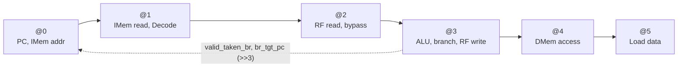
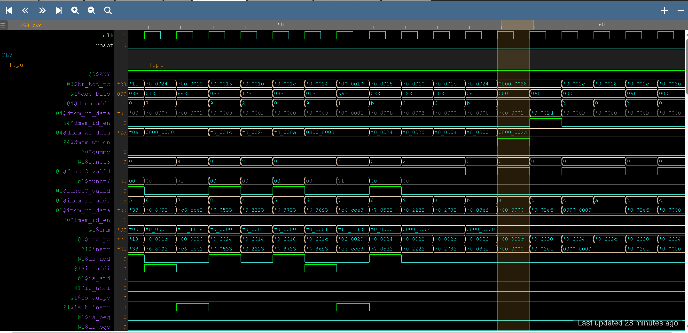
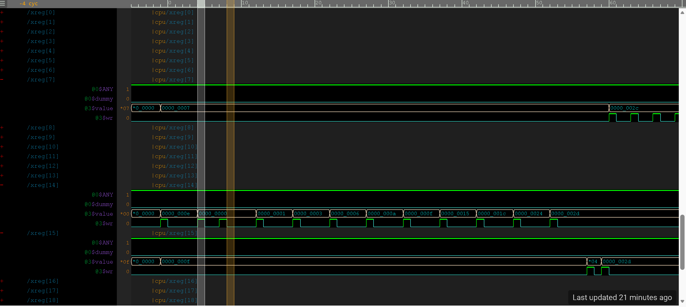
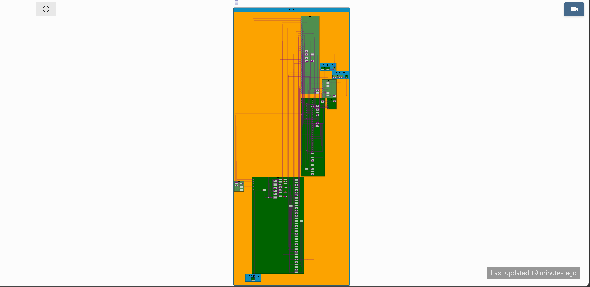

# Pipelined RISC-V (RV32I) CPU in TL-Verilog

Built in Makerchip as part of the RISC-V MYTH Workshop. The design starts as a simple single-stage core and is turned into a 4-stage pipeline that runs about one instruction per cycle. It handles register-file bypass, branch/jump/load squashing, and a data memory.

**Test program:** sum of 1 to 9 in a loop, store the result to memory, load it back, then jump to itself.
https://myth.makerchip.com/v228/ide/~0lYf5c16/p-0PmcK1


---

## Contents

0. [Setup and test program](#0-setup-and-test-program)
1. [Part 1: Single-stage core](#part-1-single-stage-core)
2. [Part 2: Pipelining](#part-2-pipelining)
3. [Bugs found and fixed](#bugs-found-and-fixed)
4. [Final code](#final-code)
5. [Screenshot checklist](#screenshot-checklist)
6. [Suggested repo layout and commits](#suggested-repo-layout-and-commits)

---

## 0. Setup and test program

**Tools:** Makerchip (browser IDE), TL-Verilog, M4 macros from the workshop library `risc-v_shell_lib.tlv`.

**Makerchip tabs used:** *Editor*, *Log* (compile errors), *Waveform*, *VIZ* (register file and memory view), *Nav-TLV* (stage view).

**Test program** (`m4_asm` immediates are binary):

| Address | Instruction | Meaning |
|---|---|---|
| `0x00` | `ADD r10, r0, r0` | r10 = 0 |
| `0x04` | `ADD r14, r10, r0` | sum = 0 |
| `0x08` | `ADDI r12, r10, 10` | limit = 10 |
| `0x0c` | `ADD r13, r10, r0` | counter = 0 |
| `0x10` | `ADD r14, r13, r14` | **loop:** sum += counter |
| `0x14` | `ADDI r13, r13, 1` | counter++ |
| `0x18` | `BLT r13, r12, -8` | if counter < limit, go to `0x10` |
| `0x1c` | `ADD r10, r14, r0` | r10 = sum (45) |
| `0x20` | `SW r10, 4(r0)` | store 45 at byte address 4 |
| `0x24` | `LW r15, 4(r0)` | load it back into r15 |
| `0x28` | `JAL r7, 0` | jump to itself (end loop) |

**Reference numbers:** 1+2+...+9 = 45 = `0x2d`. Registers reset to their own index (x5 = 5, x7 = 7, x15 = 15).


---

# Part 1: Single-stage core

In this part, all logic after fetch sits in `@1`. There are no hazards to handle yet.

## Step 1: Program counter

**Goal:** a PC that starts at 0 and increases by 4 each cycle.

**Concept:** the PC is a register, so it must read its own value from the *previous* cycle. Writing `$pc = $pc + 4` is a combinational loop. Makerchip fails with `Settle region did not converge`. Use `>>1` to read the previous cycle.

**Code**
```tlv
|cpu
   @0
      $reset = *reset;
      $pc[31:0] = >>1$reset ? 32'b0 : (>>1$pc + 32'd4);
```

**Expected result:** after reset the PC goes `0, 4, 8, c, 10, 14, ...` (hex). No compile errors.

📸 **Screenshot `01_pc.png`:** the Waveform tab with `$reset` and `$pc` (hex), cursor on a cycle after reset.

## Step 2: Instruction fetch

**Goal:** read the instruction at the PC from instruction memory.

**Concept:** the memory is word-addressed, so the index is `$pc[M4_IMEM_INDEX_CNT+1:2]`. The two low bits are always 0.

**Code**
```tlv
@0
   $imem_rd_en = !$reset;
   $imem_rd_addr[M4_IMEM_INDEX_CNT-1:0] = $pc[M4_IMEM_INDEX_CNT+1:2];
@1
   $instr[31:0] = $imem_rd_data[31:0];
...
|cpu
   m4+imem(@1)
```

**Expected result:** `$instr` follows the program: `$pc = 0` gives the encoding of `ADD r10, r0, r0`, and so on.


## Step 3: Instruction type decode

**Goal:** classify each instruction as R, I, S, B, U or J type from `$instr[6:2]`.

**Concept:** `==?` treats `x` in the pattern as "don't care", so one pattern can match several opcodes.

**Code**
```tlv
$is_i_instr = $instr[6:2] ==? 5'b0000x || $instr[6:2] ==? 5'b001x0 || $instr[6:2] ==? 5'b11001;
$is_r_instr = $instr[6:2] ==? 5'b01011 || $instr[6:2] ==? 5'b011x0 || $instr[6:2] ==? 5'b10100;
$is_s_instr = $instr[6:2] ==? 5'b0100x;
$is_b_instr = $instr[6:2] ==? 5'b11000;
$is_j_instr = $instr[6:2] ==? 5'b11011;
$is_u_instr = $instr[6:2] ==? 5'b0x101;
```

**Expected result:** exactly one type flag is 1 per instruction. ADD gives R, ADDI gives I, BLT gives B, SW gives S, JAL gives J.

> **Watch out:** the I-type pattern for JALR is `11001`, not `1100x`. `1100x` also matches the branch opcode `11000`, so every branch is also classified as I-type. See [Bugs](#bugs-found-and-fixed).


## Step 4: Immediate decode

**Goal:** build the 32-bit sign-extended immediate for each type.

**Concept:** the number of sign-extension bits is the count of bit positions from 31 down to just above the first non-sign field. Always check that the widths add up to 32.

| Type | Sign bits | Fields | Total |
|---|---|---|---|
| I | 21 (bits 31:11) | `[30:20]` (11) | 32 |
| S | 21 | `[30:25]` (6) + `[11:7]` (5) | 32 |
| B | 20 (bits 31:12) | `[7]` (1) + `[30:25]` (6) + `[11:8]` (4) + `0` (1) | 32 |
| U | 0 | `[31:12]` (20) + 12 zeros | 32 |
| J | 12 (bits 31:20) | `[19:12]` (8) + `[20]` (1) + `[30:21]` (10) + `0` (1) | 32 |

**Code**
```tlv
$imm[31:0] =
   $is_i_instr ? {{21{$instr[31]}}, $instr[30:20]} :
   $is_s_instr ? {{21{$instr[31]}}, $instr[30:25], $instr[11:7]} :
   $is_b_instr ? {{20{$instr[31]}}, $instr[7], $instr[30:25], $instr[11:8], 1'b0} :
   $is_u_instr ? {$instr[31:12], 12'b0} :
   $is_j_instr ? {{12{$instr[31]}}, $instr[19:12], $instr[20], $instr[30:21], 1'b0} :
                 32'b0;
```

**Expected result:** for `ADDI r12, r10, 10`, `$imm = 0xA`. For the BLT at `0x18`, `$imm = 0xFFFFFFF8` (-8).


## Step 5: Field extraction

**Goal:** pull out `$opcode`, `$rd`, `$funct3`, `$rs1`, `$rs2`, `$funct7`, each only when the instruction type uses it.

**Concept:** `?$valid_signal` conditions an assignment, so the field is don't-care when it does not apply. Each signal is assigned only once, in the conditioned form.

**Code**
```tlv
$opcode_valid = $is_r_instr || $is_i_instr || $is_s_instr || $is_b_instr || $is_u_instr || $is_j_instr;
?$opcode_valid
   $opcode[6:0] = $instr[6:0];
$rd_valid = $is_r_instr || $is_i_instr || $is_u_instr || $is_j_instr;
?$rd_valid
   $rd[4:0] = $instr[11:7];
$funct3_valid = $is_r_instr || $is_i_instr || $is_s_instr || $is_b_instr;
?$funct3_valid
   $funct3[2:0] = $instr[14:12];
$rs1_valid = $is_r_instr || $is_i_instr || $is_s_instr || $is_b_instr;
?$rs1_valid
   $rs1[4:0] = $instr[19:15];
$rs2_valid = $is_r_instr || $is_s_instr || $is_b_instr;
?$rs2_valid
   $rs2[4:0] = $instr[24:20];
$funct7_valid = $is_r_instr;
?$funct7_valid
   $funct7[6:0] = $instr[31:25];
```

**Expected result:** for `ADD r14, r13, r14`, `$rd = 14`, `$rs1 = 13`, `$rs2 = 14`. For `BLT`, `$rd_valid` is 0.


## Step 6: Instruction decode

**Goal:** identify the exact instruction from `{bit 30, funct3, opcode}`.

**Concept:** the 11-bit `$dec_bits` is matched with `==?`. Bit 30 is used instead of `$funct7[5]` because SLLI, SRLI and SRAI are I-type but still use bit 30 to tell them apart.

**Code** (the full set is in [Final code](#final-code); this is the subset the sum loop needs)
```tlv
$dec_bits[10:0] = {$instr[30], $funct3, $opcode};
$is_blt  = $dec_bits ==? 11'bx_100_1100011;
$is_addi = $dec_bits ==? 11'bx_000_0010011;
$is_add  = $dec_bits ==? 11'b0_000_0110011;
`BOGUS_USE($is_blt $is_addi $is_add)
```

**Expected result:** exactly one `$is_*` flag is 1 per instruction. `ADD` uses opcode `0110011`, and `ADDI` uses `0010011`.


## Step 7: Register file read and write

**Goal:** read two source registers and write one destination register.

**Concept:** `m4+rf` is a macro that creates the 32-register array. You drive its input ports and read its output ports. You do not assign `$rf_rd_data1/2`; the macro does. On reset every register holds its own index, which gives a built-in test.

**Code**
```tlv
$rf_rd_en1 = $rs1_valid;
$rf_rd_index1[4:0] = $rs1;
$rf_rd_en2 = $rs2_valid;
$rf_rd_index2[4:0] = $rs2;
$src1_value[31:0] = $rf_rd_data1;
$src2_value[31:0] = $rf_rd_data2;

$rf_wr_en = $rd_valid && $rd != 5'b0;   // x0 is hardwired to zero
$rf_wr_index[4:0] = $rd;
$rf_wr_data[31:0] = $result;
...
|cpu
   m4+rf(@1, @1)
```

**Expected result (read test):** before any write to a register, `$src1_value` equals `$rs1`, and `$src2_value` equals `$rs2`.


## Step 8: ALU (first instructions)

**Goal:** compute `$result` for ADD and ADDI.

**Code**
```tlv
$result[31:0] = $is_addi ? $src1_value + $imm :
                $is_add  ? $src1_value + $src2_value :
                           32'bx;
```

**Expected result:** `ADDI r12, r10, 10` gives `$result = 0xA`, and x12 becomes 10.


## Step 9: Branches

**Goal:** decide if a branch is taken, compute the target, and redirect the PC.

**Concept:** BLT and BGE are signed comparisons, but Verilog's `<` is unsigned here. When the sign bits differ, the unsigned result is the opposite of the signed one, so XOR with "signs differ" fixes it.

**Code**
```tlv
$taken_br =
   $is_beq  ? ($src1_value == $src2_value) :
   $is_bne  ? ($src1_value != $src2_value) :
   $is_blt  ? (($src1_value <  $src2_value) ^ ($src1_value[31] != $src2_value[31])) :
   $is_bge  ? (($src1_value >= $src2_value) ^ ($src1_value[31] != $src2_value[31])) :
   $is_bltu ? ($src1_value <  $src2_value) :
   $is_bgeu ? ($src1_value >= $src2_value) :
              1'b0;
$br_tgt_pc[31:0] = $pc + $imm;
```
and in `@0`:
```tlv
$pc[31:0] = >>1$reset ? 32'b0 :
            >>1$taken_br ? >>1$br_tgt_pc :
                           >>1$pc + 32'd4;
```

**Expected result:** the PC runs `0, 4, 8, c, 10, 14, 18`, then back to `10` while r13 < r12. `$taken_br` is 1 at `0x18` for nine passes and 0 on the last.


## Step 10: Testbench (single-stage core complete)

**Code**
```tlv
*passed = |cpu/xreg[10]>>5$value == (1+2+3+4+5+6+7+8+9);
*failed = 1'b0;
```

**Concept:** `/xreg[10]$value` is x10 inside the register-file macro. `>>5` looks 5 cycles back so the check reads the final stored value.

**Expected result:** x13 counts 1, 2, ..., 10. x14 goes 0, 1, 3, 6, 10, 15, 21, 28, 36, 45. x10 ends at 45 (`0x2d`). Makerchip shows **Passed**.


---

# Part 2: Pipelining

## P1: The waterfall diagram

**Goal:** understand how instructions overlap in time before changing any code.

**Concept**
- Each orange tube is **one instruction** moving through PC, IMem read, decode, RF read, ALU, RF write.
- Green vertical lines are stage boundaries (`@0`, `@1`, ...). Everything between two lines happens in one clock cycle.
- The second tube is the **next instruction**, shifted one cycle later (`>>1`). While instruction 1 is in decode, instruction 2 is being fetched. This overlap is the speed-up.
- The wires between tubes are **inter-instruction dependencies**:
  1. **PC feedback:** the next PC comes from the previous instruction (PC + 4 or the branch target).
  2. **RF write to RF read:** a value written by one instruction may be read by the next.

In a single stage these dependencies are invisible. Once logic is spread across stages, they become **hazards**:
- **Branch hazard:** `$taken_br` is known in `@3`, but the next instructions are already fetched. Squash them.
- **Read-after-write hazard:** an instruction reads a register before the previous one has written it. Fix with bypass.


## P2: Safe first step, one instruction every 3 cycles

**Goal:** make the pipeline correct before making it fast.

**Concept:** if a new instruction starts only every 3 cycles, each one finishes before the next one needs its results, so no hazard can happen. A `$valid` signal repeating `1, 0, 0` does this.

**Code** (in `@3`, alongside the ALU and branch logic)
```tlv
$start = >>1$reset && !$reset;          // first cycle after reset
$valid = $reset ? 1'b0 :
         $start ? 1'b1 :
                  >>3$valid;            // repeat every 3 cycles
```

**Expected result:** after reset, `$valid` follows `1, 0, 0, 1, 0, 0, ...`.

.

## P3: Gate the write and the PC with `$valid`

**Goal:** bubbles (`$valid = 0`) must not change state.

**Code**
```tlv
// @3
$rf_wr_en = $rd_valid && $rd != 5'd0 && $valid;   // no RF write for invalid instructions
$valid_taken_br = $valid && $taken_br;            // no redirect for invalid branches

// @0   (note >>3 for both the branch and inc_pc in 3-cycle mode)
$inc_pc[31:0] = $pc + 32'd4;
$pc[31:0] = >>1$reset ? 32'b0 :
            >>3$valid_taken_br ? >>3$br_tgt_pc :
                                 >>3$inc_pc;
```

**Concept:** in this slow mode the next valid instruction comes from the previous *valid* instruction, which was 3 cycles ago. So `$inc_pc` is read with `>>3`. When we later move to one instruction per cycle, it goes back to `>>1` (see P5).

**Expected result:** on cycles where `$valid = 1`, the PC follows `0, 4, 8, c, 10, 14, 18`, then `10`. The PC value on bubble cycles is don't-care.


## P4: Partition logic into stages

**Goal:** move each function into its own pipeline stage.

| Stage | Contents |
|---|---|
| `@0` | `$reset`, PC mux, `$inc_pc`, `$imem_rd_en`, `$imem_rd_addr` |
| `@1` | `$instr`, type decode, `$imm`, field extraction, `$dec_bits`, `$is_*` |
| `@2` | RF read (`$rf_rd_en/index`), `$src1_value`, `$src2_value` |
| `@3` | ALU `$result`, `$taken_br`, `$br_tgt_pc`, `$valid`, RF write |
| `@4` | data memory access (added in P9) |
| `@5` | `$ld_data` (added in P9) |



**Code (macros)**
```tlv
|cpu
   m4+imem(@1)
   m4+rf(@2, @3)      // read in @2, write in @3 (implies >>2)
```

**Concept:** a signal can only be used in the same stage or a later one. `$result` is computed in `@3`, so `$rf_wr_data` must also be in `@3`, not `@2`.

**Expected result:** the program still passes with the same results as P3.


## P5: Register-file bypass (about 1 instruction per cycle)

**Goal:** remove the 3-cycle spacing.

**Concept:** with one instruction per cycle, `ADDI r13, r13, 1` is in `@3` producing a result while `BLT r13, ...` is in `@2` reading r13. The RF does not have the new value yet. The fix is to forward what the previous instruction is *about to write*.

**Code** (in `@2`)
```tlv
$src1_value[31:0] = (>>1$rf_wr_en && (>>1$rf_wr_index == $rf_rd_index1)) ? >>1$rf_wr_data : $rf_rd_data1;
$src2_value[31:0] = (>>1$rf_wr_en && (>>1$rf_wr_index == $rf_rd_index2)) ? >>1$rf_wr_data : $rf_rd_data2;
```
and in `@0` the PC goes back to a one-cycle step:
```tlv
>>1$inc_pc     // instead of >>3$inc_pc
```
Delete `$start` and the 3-cycle `$valid`.

**Concept notes**
- `$rf_wr_en` already includes `$valid` and `$rd != 0`, so bubbles and x0 never trigger a bypass.
- Forward `$rf_wr_data`, not `$result`. They are equal for normal instructions, but later `$rf_wr_data` also carries load data.

**Expected result:** x14 and x13 still reach the right values, now in far fewer cycles.


## P6: Branch redirect and squash (2 dead cycles)

**Goal:** handle the branch hazard at one instruction per cycle.

**Concept:** a branch is resolved in `@3`. By then two more instructions have been fetched down the wrong path. Mark them invalid for 2 cycles. Without a branch predictor, this is a 2-cycle penalty on every taken branch.

**Code**
```tlv
// @3
$valid = !(>>1$valid_taken_br || >>2$valid_taken_br);

// @0
$pc[31:0] = >>1$reset ? 32'b0 :
            >>3$valid_taken_br ? >>3$br_tgt_pc :
                                 >>1$inc_pc;
```

**Timeline for a taken branch (BLT at `0x18`):**
```
cycle      n      n+1     n+2     n+3
BLT        @3
0x1c               (valid=0, squashed)
0x20                       (valid=0, squashed)
0x10                               fetched (branch target)
```

**Expected result:** after each taken BLT, `$valid` drops to 0 for two cycles, then the PC returns to `0x10`. r14 still ends at 45.


## P7: Full ALU

**Goal:** implement every RV32I arithmetic, logic, shift and compare instruction.

**Concept:** SLT, SLTI, SRA and SRAI need intermediate signals. Arithmetic right shift is done by shifting a 64-bit value that has 32 copies of the sign bit on top, then taking the low 32 bits.

**Code** (in `@3`; the decode flags for every instruction are in [Final code](#final-code))
```tlv
$sltu_rslt[31:0]  = {31'b0, $src1_value < $src2_value};
$sltiu_rslt[31:0] = {31'b0, $src1_value < $imm};
$sext_src1[63:0]  = {{32{$src1_value[31]}}, $src1_value};
$sra_rslt[63:0]   = $sext_src1 >> $src2_value[4:0];
$srai_rslt[63:0]  = $sext_src1 >> $imm[4:0];

$result[31:0] =
     $is_andi  ? $src1_value & $imm :
     $is_ori   ? $src1_value | $imm :
     $is_xori  ? $src1_value ^ $imm :
     $is_addi  ? $src1_value + $imm :
     $is_slli  ? $src1_value << $imm[5:0] :
     $is_srli  ? $src1_value >> $imm[5:0] :
     $is_and   ? $src1_value & $src2_value :
     $is_or    ? $src1_value | $src2_value :
     $is_xor   ? $src1_value ^ $src2_value :
     $is_add   ? $src1_value + $src2_value :
     $is_sub   ? $src1_value - $src2_value :
     $is_sll   ? $src1_value << $src2_value[4:0] :
     $is_srl   ? $src1_value >> $src2_value[4:0] :
     $is_sltu  ? $sltu_rslt :
     $is_sltiu ? $sltiu_rslt :
     $is_lui   ? {$imm[31:12], 12'b0} :
     $is_auipc ? $pc + $imm :
     $is_jal   ? $pc + 32'd4 :
     $is_jalr  ? $pc + 32'd4 :
     $is_srai  ? $srai_rslt[31:0] :
     $is_slt   ? (($src1_value[31] == $src2_value[31]) ? $sltu_rslt  : {31'b0, $src1_value[31]}) :
     $is_slti  ? (($src1_value[31] == $imm[31])        ? $sltiu_rslt : {31'b0, $src1_value[31]}) :
     $is_sra   ? $sra_rslt[31:0] :
     $is_load  ? $src1_value + $imm :
     $is_s_instr ? $src1_value + $imm :
                 32'bx;
```

**Expected result:** the sum program is unchanged and still passes. Only the sum-loop instructions are exercised by default. To test others, add a few `m4_asm` lines (for example `SUB`, `AND`, `SLLI`) and check the result in the waveform.


## P8: Jumps (JAL and JALR)

**Goal:** unconditional jumps that also write a link address.

**Concept:** JAL's target is `PC + imm`, the same as the branch target. JALR's target is `rs1 + imm`. Both write `PC + 4` to `rd`. Like a taken branch, the two instructions fetched after a jump are squashed.

**Code**
```tlv
// @3
$jalr_tgt_pc[31:0] = $src1_value + $imm;
$valid_jump = $valid && ($is_jal || $is_jalr);
$valid = !(>>1$valid_taken_br || >>2$valid_taken_br ||
           >>1$valid_jump     || >>2$valid_jump);   // load terms are added in P9

// @0
$pc[31:0] = >>1$reset ? 32'b0 :
            >>3$valid_taken_br              ? >>3$br_tgt_pc :
            (>>3$valid_jump && >>3$is_jal)  ? >>3$br_tgt_pc :
            (>>3$valid_jump && >>3$is_jalr) ? >>3$jalr_tgt_pc :
                                              >>1$inc_pc;
```

**How to test:** add the end loop after the last instruction.
```tlv
m4_asm(JAL, r7, 00000000000000000000)   // jump to itself
```

**Expected result:** the PC stays on the JAL (`0x28`) and the two squashed instructions after it, repeating `28, 2c, 30, 28, ...`. `$valid` follows `1, 0, 0, 1, 0, 0`. x7 changes from 7 to `0x2c` (JAL's PC + 4).

> **Test tip:** to see x7 change, temporarily use `*passed = *cyc_cnt > 70;` so the run does not stop first. Restore the real testbench afterwards. The first JAL pass right after the `LW` is squashed by the load shadow, and the refetch is the real one.


## P9: Loads and stores

**Goal:** add the data memory, load data write-back, and the load shadow.

**Concept**
- Address calculation is `rs1 + imm`, the same as ADDI, for both loads and stores.
- Data memory is accessed in `@4`, and load data is available in `@5`, two cycles after the ALU stage.
- So a load needs a **2-instruction shadow** (like a branch), and the **load data is written to the RF two instructions later**, using the free write port in the squashed slots.
- The PC redirect after a load refetches the instruction right after the load, which was squashed.

**Code**
```tlv
// @1 (with the decode)
$is_load = $is_lb || $is_lh || $is_lw || $is_lbu || $is_lhu;

// @3
$valid_load = $valid && $is_load;
$valid = !(>>1$valid_taken_br || >>2$valid_taken_br ||
           >>1$valid_load     || >>2$valid_load     ||
           >>1$valid_jump     || >>2$valid_jump);

$rf_wr_en = ($rd_valid && $valid && $rd != 5'd0) || >>2$valid_load;
$rf_wr_index[4:0] = >>2$valid_load ? >>2$rd : $rd;
$rf_wr_data[31:0] = >>2$valid_load ? >>2$ld_data : $result;

// @4
$dmem_wr_en = $is_s_instr && $valid;
$dmem_addr[3:0] = $result[5:2];       // 16-word memory, word index
$dmem_wr_data[31:0] = $src2_value;
$dmem_rd_en = $valid_load;

// @5
$ld_data[31:0] = $dmem_rd_data;

// @0, added to the PC mux:
>>3$valid_load ? >>3$inc_pc :         // refetch the instruction after the load
```

and in the macros:
```tlv
|cpu
   m4+dmem(@4)
```

**Testbench for the final program**
```tlv
*passed = |cpu/xreg[15]>>5$value == (1+2+3+4+5+6+7+8+9);
*failed = 1'b0;
```

**Expected result**
- At the `SW`: `$dmem_wr_en = 1`, `$dmem_wr_data = 0x2d`. The VIZ memory view shows word 1 = 45.
- At the `LW`: `$valid_load = 1`, then `$valid = 0` for two cycles.
- Two cycles after the LW: `$rf_wr_en = 1`, `$rf_wr_index = 15`, `$rf_wr_data = 0x2d`.
- `/xreg[15]$value` goes from 15 to 45 and `*passed` goes high.


## P10: Final run

**Expected result:** the full program passes. x14 ends at 45, x10 is 45, memory word 1 holds 45, x15 is 45, and x7 holds `0x2c` after the end loop.






---

# Bugs found and fixed

These came up while building. They make a useful section for an interviewer, because each one shows a real debug.

| # | Symptom | Cause | Fix |
|---|---|---|---|
| 1 | `Settle region did not converge` | `$pc` defined from itself in the same cycle (combinational loop) | read the previous cycle: `>>1$pc` |
| 2 | Wrong branch target | B-immediate used 19 sign bits plus a duplicated `inst[7]` | `{{20{$instr[31]}}, $instr[7], ...}` |
| 3 | Wrong jump target | J-immediate used 11 sign bits | use 12 |
| 4 | Width mismatch | `$funct7[7:0]` for a 7-bit field | `$funct7[6:0]` |
| 5 | `$is_add` also true for ADDI | copied the I-type opcode `0010011` | R-type opcode `0110011` |
| 6 | `BGE` never taken on equal | used `>` instead of `>=` | `>=` |
| 7 | Typos `$funt3_valid`, `$funt7_valid` | undefined signals | corrected spelling |
| 8 | PC jumped to `0x4`, r14 stuck at 0 | `$is_i_instr` pattern `1100x` also matched the branch opcode, so BLT got the I-immediate (-20) | I-type JALR pattern `5'b11001` |
| 9 | RF read stage wrong | `m4+rf(@1,@3)` with reads placed in `@2` | `m4+rf(@2,@3)` |
| 10 | `$rf_wr_data` in `@2` using `$result` from `@3` | used a later-stage signal in an earlier stage | move the write signals to `@3` |
| 11 | PC advanced wrongly in 3-cycle mode | `$inc_pc` computed from `>>1$pc` | `$inc_pc = $pc + 32'd4`, read as `>>3$inc_pc` |
| 12 | Bypass forwarded garbage after a load | forwarded `>>1$result` when the write was load data | forward `>>1$rf_wr_data` |

---

# Final code

Complete `|cpu` block with all fixes applied.

```tlv
|cpu
   @0
      $reset = *reset;
      $inc_pc[31:0] = $pc + 32'd4;
      $imem_rd_en = !$reset;
      $pc[31:0] = >>1$reset ? 32'b0 :
                  >>3$valid_taken_br              ? >>3$br_tgt_pc :
                  (>>3$valid_jump && >>3$is_jal)  ? >>3$br_tgt_pc :
                  (>>3$valid_jump && >>3$is_jalr) ? >>3$jalr_tgt_pc :
                  >>3$valid_load                  ? >>3$inc_pc :
                                                    >>1$inc_pc;
      $imem_rd_addr[M4_IMEM_INDEX_CNT-1:0] = $pc[M4_IMEM_INDEX_CNT+1:2];

   @1
      $instr[31:0] = $imem_rd_data[31:0];
      $is_i_instr = $instr[6:2] ==? 5'b0000x || $instr[6:2] ==? 5'b001x0 || $instr[6:2] ==? 5'b11001;
      $is_r_instr = $instr[6:2] ==? 5'b01011 || $instr[6:2] ==? 5'b011x0 || $instr[6:2] ==? 5'b10100;
      $is_s_instr = $instr[6:2] ==? 5'b0100x;
      $is_b_instr = $instr[6:2] ==? 5'b11000;
      $is_j_instr = $instr[6:2] ==? 5'b11011;
      $is_u_instr = $instr[6:2] ==? 5'b0x101;

      $imm[31:0] =
         $is_i_instr ? {{21{$instr[31]}}, $instr[30:20]} :
         $is_s_instr ? {{21{$instr[31]}}, $instr[30:25], $instr[11:7]} :
         $is_b_instr ? {{20{$instr[31]}}, $instr[7], $instr[30:25], $instr[11:8], 1'b0} :
         $is_u_instr ? {$instr[31:12], 12'b0} :
         $is_j_instr ? {{12{$instr[31]}}, $instr[19:12], $instr[20], $instr[30:21], 1'b0} :
                       32'b0;

      $opcode_valid = $is_r_instr || $is_i_instr || $is_s_instr || $is_b_instr || $is_u_instr || $is_j_instr;
      ?$opcode_valid
         $opcode[6:0] = $instr[6:0];
      $rd_valid = $is_r_instr || $is_i_instr || $is_u_instr || $is_j_instr;
      ?$rd_valid
         $rd[4:0] = $instr[11:7];
      $funct3_valid = $is_r_instr || $is_i_instr || $is_s_instr || $is_b_instr;
      ?$funct3_valid
         $funct3[2:0] = $instr[14:12];
      $rs1_valid = $is_r_instr || $is_i_instr || $is_s_instr || $is_b_instr;
      ?$rs1_valid
         $rs1[4:0] = $instr[19:15];
      $rs2_valid = $is_r_instr || $is_s_instr || $is_b_instr;
      ?$rs2_valid
         $rs2[4:0] = $instr[24:20];
      $funct7_valid = $is_r_instr;
      ?$funct7_valid
         $funct7[6:0] = $instr[31:25];

      $dec_bits[10:0] = {$instr[30], $funct3, $opcode};
      // Upper / jumps
      $is_lui   = $dec_bits ==? 11'bx_xxx_0110111;
      $is_auipc = $dec_bits ==? 11'bx_xxx_0010111;
      $is_jal   = $dec_bits ==? 11'bx_xxx_1101111;
      $is_jalr  = $dec_bits ==? 11'bx_000_1100111;
      // Branches
      $is_beq   = $dec_bits ==? 11'bx_000_1100011;
      $is_bne   = $dec_bits ==? 11'bx_001_1100011;
      $is_blt   = $dec_bits ==? 11'bx_100_1100011;
      $is_bge   = $dec_bits ==? 11'bx_101_1100011;
      $is_bltu  = $dec_bits ==? 11'bx_110_1100011;
      $is_bgeu  = $dec_bits ==? 11'bx_111_1100011;
      // Loads
      $is_lb    = $dec_bits ==? 11'bx_000_0000011;
      $is_lh    = $dec_bits ==? 11'bx_001_0000011;
      $is_lw    = $dec_bits ==? 11'bx_010_0000011;
      $is_lbu   = $dec_bits ==? 11'bx_100_0000011;
      $is_lhu   = $dec_bits ==? 11'bx_101_0000011;
      // Stores
      $is_sb    = $dec_bits ==? 11'bx_000_0100011;
      $is_sh    = $dec_bits ==? 11'bx_001_0100011;
      $is_sw    = $dec_bits ==? 11'bx_010_0100011;
      // Immediate ALU
      $is_addi  = $dec_bits ==? 11'bx_000_0010011;
      $is_slti  = $dec_bits ==? 11'bx_010_0010011;
      $is_sltiu = $dec_bits ==? 11'bx_011_0010011;
      $is_xori  = $dec_bits ==? 11'bx_100_0010011;
      $is_ori   = $dec_bits ==? 11'bx_110_0010011;
      $is_andi  = $dec_bits ==? 11'bx_111_0010011;
      $is_slli  = $dec_bits ==? 11'b0_001_0010011;
      $is_srli  = $dec_bits ==? 11'b0_101_0010011;
      $is_srai  = $dec_bits ==? 11'b1_101_0010011;
      // Register ALU
      $is_add   = $dec_bits ==? 11'b0_000_0110011;
      $is_sub   = $dec_bits ==? 11'b1_000_0110011;
      $is_sll   = $dec_bits ==? 11'b0_001_0110011;
      $is_slt   = $dec_bits ==? 11'b0_010_0110011;
      $is_sltu  = $dec_bits ==? 11'b0_011_0110011;
      $is_xor   = $dec_bits ==? 11'b0_100_0110011;
      $is_srl   = $dec_bits ==? 11'b0_101_0110011;
      $is_sra   = $dec_bits ==? 11'b1_101_0110011;
      $is_or    = $dec_bits ==? 11'b0_110_0110011;
      $is_and   = $dec_bits ==? 11'b0_111_0110011;

      $is_load = $is_lb || $is_lh || $is_lw || $is_lbu || $is_lhu;
      `BOGUS_USE($is_lui $is_auipc $is_jal $is_jalr $is_beq $is_bne $is_blt $is_bge $is_bltu $is_bgeu
                 $is_lb $is_lh $is_lw $is_lbu $is_lhu $is_sb $is_sh $is_sw
                 $is_addi $is_slti $is_sltiu $is_xori $is_ori $is_andi $is_slli $is_srli $is_srai
                 $is_add $is_sub $is_sll $is_slt $is_sltu $is_xor $is_srl $is_sra $is_or $is_and)

   @2
      $rf_rd_en1 = $rs1_valid;
      $rf_rd_index1[4:0] = $rs1;
      $rf_rd_en2 = $rs2_valid;
      $rf_rd_index2[4:0] = $rs2;

      $src1_value[31:0] = (>>1$rf_wr_en && (>>1$rf_wr_index == $rf_rd_index1)) ? >>1$rf_wr_data : $rf_rd_data1;
      $src2_value[31:0] = (>>1$rf_wr_en && (>>1$rf_wr_index == $rf_rd_index2)) ? >>1$rf_wr_data : $rf_rd_data2;

   @3
      // Intermediates
      $sltu_rslt[31:0]  = {31'b0, $src1_value < $src2_value};
      $sltiu_rslt[31:0] = {31'b0, $src1_value < $imm};
      $sext_src1[63:0]  = {{32{$src1_value[31]}}, $src1_value};
      $sra_rslt[63:0]   = $sext_src1 >> $src2_value[4:0];
      $srai_rslt[63:0]  = $sext_src1 >> $imm[4:0];

      $result[31:0] =
           $is_andi  ? $src1_value & $imm :
           $is_ori   ? $src1_value | $imm :
           $is_xori  ? $src1_value ^ $imm :
           $is_addi  ? $src1_value + $imm :
           $is_slli  ? $src1_value << $imm[5:0] :
           $is_srli  ? $src1_value >> $imm[5:0] :
           $is_and   ? $src1_value & $src2_value :
           $is_or    ? $src1_value | $src2_value :
           $is_xor   ? $src1_value ^ $src2_value :
           $is_add   ? $src1_value + $src2_value :
           $is_sub   ? $src1_value - $src2_value :
           $is_sll   ? $src1_value << $src2_value[4:0] :
           $is_srl   ? $src1_value >> $src2_value[4:0] :
           $is_sltu  ? $sltu_rslt :
           $is_sltiu ? $sltiu_rslt :
           $is_lui   ? {$imm[31:12], 12'b0} :
           $is_auipc ? $pc + $imm :
           $is_jal   ? $pc + 32'd4 :
           $is_jalr  ? $pc + 32'd4 :
           $is_srai  ? $srai_rslt[31:0] :
           $is_slt   ? (($src1_value[31] == $src2_value[31]) ? $sltu_rslt  : {31'b0, $src1_value[31]}) :
           $is_slti  ? (($src1_value[31] == $imm[31])        ? $sltiu_rslt : {31'b0, $src1_value[31]}) :
           $is_sra   ? $sra_rslt[31:0] :
           $is_load  ? $src1_value + $imm :
           $is_s_instr ? $src1_value + $imm :
                       32'bx;

      $taken_br =
         $is_beq  ? ($src1_value == $src2_value) :
         $is_bne  ? ($src1_value != $src2_value) :
         $is_blt  ? (($src1_value <  $src2_value) ^ ($src1_value[31] != $src2_value[31])) :
         $is_bge  ? (($src1_value >= $src2_value) ^ ($src1_value[31] != $src2_value[31])) :
         $is_bltu ? ($src1_value <  $src2_value) :
         $is_bgeu ? ($src1_value >= $src2_value) :
                    1'b0;

      $br_tgt_pc[31:0]   = $pc + $imm;
      $jalr_tgt_pc[31:0] = $src1_value + $imm;

      $valid_taken_br = $valid && $taken_br;
      $valid_jump     = $valid && ($is_jal || $is_jalr);
      $valid_load     = $valid && $is_load;
      $valid = !(>>1$valid_taken_br || >>2$valid_taken_br ||
                 >>1$valid_load     || >>2$valid_load     ||
                 >>1$valid_jump     || >>2$valid_jump);

      $rf_wr_en = ($rd_valid && $valid && $rd != 5'd0) || >>2$valid_load;
      $rf_wr_index[4:0] = >>2$valid_load ? >>2$rd : $rd;
      $rf_wr_data[31:0] = >>2$valid_load ? >>2$ld_data : $result;

   @4
      $dmem_wr_en = $is_s_instr && $valid;
      $dmem_addr[3:0] = $result[5:2];
      $dmem_wr_data[31:0] = $src2_value;
      $dmem_rd_en = $valid_load;

   @5
      $ld_data[31:0] = $dmem_rd_data;

// Testbench
*passed = |cpu/xreg[15]>>5$value == (1+2+3+4+5+6+7+8+9);
*failed = 1'b0;

|cpu
   m4+imem(@1)
   m4+rf(@2, @3)
   m4+dmem(@4)

m4+cpu_viz(@4)
```


